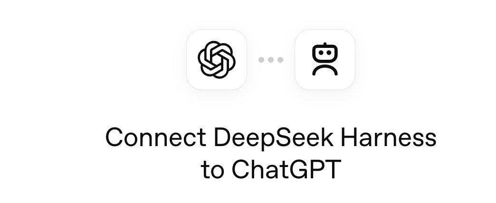
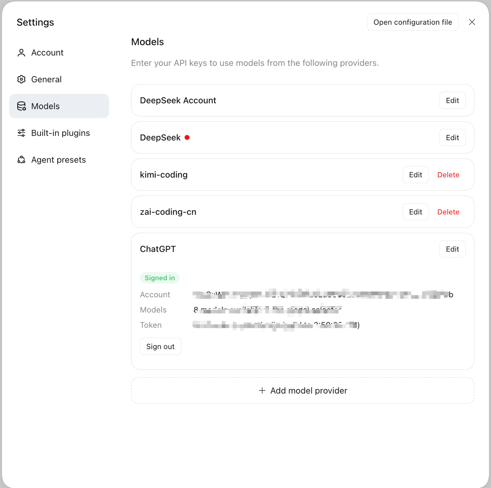
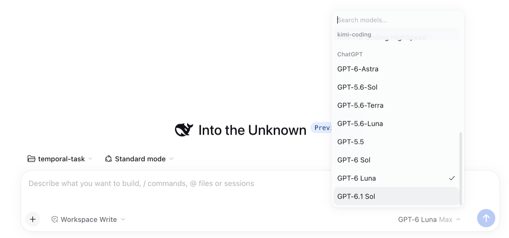
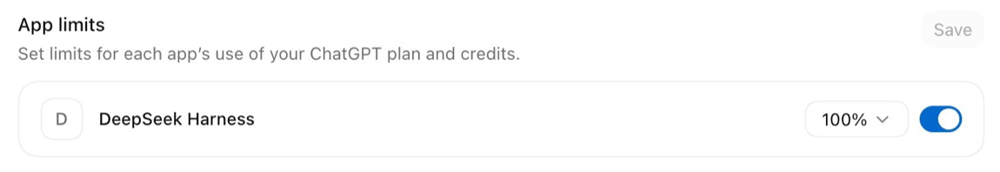

# dsh-plugin-chatgpt

English | [中文](docs/README.zh.md)

Adds one DeepSeek Harness provider route, `chatgpt`, for models served through your ChatGPT subscription. Existing subscription models use OpenAI's published *Sign in with ChatGPT* (SIWC) flow and the account's model catalog. The experimental **GPT-6 Pro · Web** model uses a separate dedicated browser connection. The route is named `chatgpt` because the built-in pi-ai plugin already owns `openai`.



## Table of Contents

- [Use this package](#use-this-package)
- [Experimental ChatGPT Web Pro](#chatgpt-web-pro)
- [What you get](#what-you-get)
- [Understand the implementation](#understand-the-implementation)
- [Further Exploration](#further-exploration)
- [Model Experience](#model-experience)
- [Known Limitations and Deferred Work](#known-limitations-and-deferred-work)
- [Dev Note](#dev-note)

-----

<a id="use-this-package"></a>
## Use this package

### Install into a profile

The whole install is one line:

```text
dsh plugin --profile <name> add dsh-plugin-chatgpt
```

Restart the harness afterwards: a profile is composed at startup. Removing it:

```text
dsh plugin --profile <name> remove dsh-plugin-chatgpt
```

The package is on npm, so the registry is the whole install and no build step is involved:

```text
dsh plugin --profile <name> add dsh-plugin-chatgpt@0.1.9   # pin a version, or omit it for the latest
```

Installing from a repository URL instead builds from source, and pnpm refuses a git dependency's build scripts until they are allowlisted: `add https://github.com/ckanner/dsh-plugin-chatgpt` fails with `ERR_PNPM_GIT_DEP_PREPARE_NOT_ALLOWED` until `dsh-plugin-chatgpt` is approved under `onlyBuiltDependencies` in the profile's `pnpm-workspace.yaml`.

The package declares `dsh.bundle`, so adding it appends the bundle to the profile's `dsh.profile.bundles` and inserts its row into the composition. Verify the layer without booting:

```text
dsh --profile <name> --dump-config   # shows a "# == dsh-plugin-chatgpt" layer
```

A package installing without a `dsh.bundle` declaration activates no layer; `dsh plugin` warns instead.

### Sign in

Open **Settings → Models**. The plugin owns a **ChatGPT** row, and the card on that row offers **Sign in with ChatGPT**. The card shows the authorization URL and selects it for copying, accepts the final redirect URL pasted back when the browser cannot reach the loopback address, and afterwards reports the account — its plan, the token's next refresh, and how many models it offers — with a **Sign out** button. No token reaches the page.

Signing out revokes the renewable session at the authorization server before clearing it locally, and says so when the server did not confirm.

To proxy this plugin's server-side requests, set `DSH_CHATGPT_PROXY_URL=http://127.0.0.1:7897` in the DSH process environment, or set `proxyUrl` in this plugin's profile configuration, then restart DSH. The URL must name an HTTP or HTTPS proxy. This covers the OAuth token exchange, refresh, discovery/revocation, model listing, and inference. It does not change DSH's global network settings or the browser's connection to the authorization page. The proxy must be reachable from the machine running DSH; `127.0.0.1` refers to that machine. Leave the setting empty for direct requests. A `403 unsupported_country_region_territory` is a server refusal, so proxy connectivity alone does not establish that sign-in is permitted.

An explicit profile `proxyUrl` takes precedence over `DSH_CHATGPT_PROXY_URL`; setting it to an empty string selects direct requests.



A headless harness drives the same session object with no browser at all:

```js
import { ChatGptAuth } from 'dsh-plugin-chatgpt/src/auth/manager.ts'

const auth = new ChatGptAuth({
  stateDir: `${process.env.DSH_HOME ?? `${process.env.HOME}/.dsh`}/chatgpt-subscription`,
  agentNameHint: 'DeepSeek Harness',
})

const attempt = await auth.begin()
console.log('Open this URL in your browser:\n' + attempt.authorizationUrl)

// The browser redirects to the loopback listener this attempt bound. If the
// redirect cannot reach it — a headless host, or a blocked popup — paste the
// final URL back instead.
// await attempt.submit('<the full redirect URL from your browser>')

const credential = await attempt.result
auth.adopt(credential)
```

The grant is stored owner-only under `stateDir`. `attempt.submit()` rejects a malformed or mismatched value and leaves the attempt open, so a mistyped paste can be corrected.

-----

<a id="chatgpt-web-pro"></a>
## Experimental ChatGPT Web Pro

The `0.2.0-alpha.1` development candidate adds `chatgpt` / `gpt-6-pro-web` / `pro` to DSH's native model and effort controls. It is not yet published to npm. The Web model is disabled by default and requires the maintained, exact-base [DSH compatibility patch](compat/README.md) for commit `ca33fd6843b205e279c7ccb6cb73a472c78f5760` (`0.2.2-rc.4`); installing a plugin into a stock SDK does not supply those host extensions.

In the existing ChatGPT provider card, configure absolute paths for Chrome, a dedicated browser profile, and a separate private recovery directory. Save, click **Connect / verify login**, complete the website login manually in that browser, then click **Connect / verify login** again. Enable **GPT-6 Pro · Web** and select **Pro** in the normal model picker. This connection is independent of SIWC sign-in and its account-catalog models.

The default Web context is a private `project-only` project for each session generation. DSH owns local tools and permissions, validates complete structured responses before executing tools, and uses its single compaction engine with the Web pressure and summary policies. Compatible turns send incremental history; generation migration uses DSH's authoritative history. The model can serve planning, review, and execution roles according to each caller's permissions.

Interrupted Web work keeps separate dispatch, outcome, local cleanup, and remote-generation facts. Inspecting recovery sends no prompt and executes no tool. Explicitly adopting a captured response may execute its validated tools, but does not automatically request another model answer. Unknown remote or tool outcomes fence the execution domain; unknown website usage remains unknown.

Signed-in macOS Desktop use against the current ChatGPT website still needs end-to-end acceptance. Durable image uploads, bounded syntax correction, and explicit discard of terminal rejected responses are implemented and covered by offline fixtures. Image consumption by the model is unverified; ambiguous website full-context refusals and project creation remain conservatively blocked. See the complete [Web Pro setup, budgets, recovery, and validation boundaries](docs/web-pro.md) before enabling the candidate.

-----

<a id="what-you-get"></a>
## What you get

One provider route, listed in **Settings → Models** like any built-in provider. Existing SIWC models follow the account's catalog; the explicitly enabled Web model appears alongside them. Selecting a model there puts it in the normal model selector.

For the existing SIWC models, metadata comes from the account listing. By default the adapter follows each model's advertised context window, including updates when the catalog refreshes. Set `contextWindowLimit` for a global budget or `modelContextWindowLimits` for individual models; explicit values are used as-is. Web Pro has a separate local byte policy described above. Sign-in lives on that row's card.

For example, add this field to the plugin's configuration to set DSH's context budget to 1,000,000 tokens for models without an individual override, even if the catalog reports a maximum of 872,000. Remove it to restore account defaults for those models. These settings are independent of Codex settings. DSH still reserves headroom for compaction; they do not change service-side request limits.

```yaml
contextWindowLimit: 1000000
```

For separate model budgets, use exact model IDs as dictionary keys. The priority is individual model, then global budget, then account default. In this example Astra uses 1,000,000, Sol uses 800,000, and other models use 500,000. The global field is optional; omit it to let other models follow their account defaults.

```yaml
contextWindowLimit: 500000
modelContextWindowLimits:
  gpt-6-astra: 1000000
  gpt-6.1-sol: 800000
```

Changes take effect the next time DSH resolves a model. Removing a model entry restores the current global budget, or its account default when no global budget is set. Keys are case-sensitive exact IDs, not display names or wildcard patterns.



The share of the plan this installation may spend is set per app, in ChatGPT settings:



-----

<a id="understand-the-implementation"></a>
## Understand the implementation

<details>
<summary>Implementation internals — click to expand</summary>

| Source | Responsibility |
|---|---|
| `cordis.patch.yml` | The layer: one inserted row naming the route and the state directory. |
| `src/index.ts` | The plugin entry: owns the adapter instance and registers the route. |
| `src/auth/protocol.ts` | The exact endpoints, scopes, and loopback rules of the published flow. |
| `src/auth/sign-in.ts` | Authorization: loopback listener and pasted redirect URL, raced. |
| `src/auth/manager.ts` | Stored grants, the active account, and single-flight refresh. |
| `src/auth/store.ts` | Atomic, owner-only credential storage. |
| `src/api/events.ts` | Decoding the Responses event stream and its failure modes. |
| `src/convert/request.ts` | Harness request to Responses body, including the fields the route refuses. |
| `src/convert/harness.ts` | DSH request boundary, including session identity and replay metadata. |
| `src/convert/images.ts` | Resolve durable user/tool images, retain host offloads, reject unsupported content before inference. |
| `src/convert/replay.ts` | Validated native output and DSH replay envelopes, scoped to an account and model. |
| `src/convert/blocks.ts` | Wire events to the harness's numbered content blocks. |
| `src/api/client.ts` | The two HTTP calls: list models, run one turn. |
| `src/models/describe.ts` | Availability and capacities, preferring what the account reports over the bundled catalog. |
| `src/adapter.ts` | The harness-facing half of the provider contract. |
| `src/web/host.ts` and `src/web/integration.ts` | Web binding, execution-domain ownership, public DSH hooks, and recovery adoption. |
| `src/web/session-coordinator.ts` and `src/web/protocol.ts` | Incremental browser generations, durable delivery, and complete local-tool response validation. |
| `src/web/transport.ts` and `src/web/browser/` | Dedicated Chrome control, observed activity, immutable response artifacts, and separate cleanup facts. |

Three SIWC rules the code enforces rather than documents:

- A request never carries `temperature`, `max_output_tokens`, `top_p`, `truncation`, or the other fields the plan-usage route refuses. They are named in `REFUSED_FIELDS` so they cannot be reintroduced by accident.
- `response.completed` is the only successful terminal. A stream that ends without one is an error, because a truncated answer that reads as finished is worse than a visible failure.
- **Account metadata is read at run time.** The plugin requests `GET /v1/models` with the selected account's grant. The bundled catalog fills missing metadata, and the dated measured list can add unlisted models. Model availability and context capacity are separate from the context budget reported to DSH.

</details>

-----

<a id="further-exploration"></a>
## Further Exploration

- [Sign in with ChatGPT: OSS token sharing](https://developers.openai.com/siwc/token-sharing-open-source) — the published flow this implements.
- [Models and inference](https://developers.openai.com/siwc/token-sharing-open-source/models-and-inference) — the listing and request constraints.
- [Preview limitations](https://developers.openai.com/siwc/token-sharing-open-source/preview-limitations) — the capabilities this route does not have yet.

-----

<a id="model-experience"></a>
## Model Experience

The context and cache behavior in this section describes the existing SIWC models. This bundle inserts one provider row, and that row's plugin owns its model-facing behavior; the layer itself contributes no prompt, tool, or context. Web Pro uses the separate browser and structured-tool contract documented in its guide.

### Request context and condition

#### What the model sees

For every turn routed to `chatgpt`, the adapter preserves the order of messages, assistant blocks, tool calls, and results. System and developer instructions become developer messages at their original positions. DSH is told to append system-prompt updates in history. Native assistant output, including encrypted reasoning, is retained in DSH's `replayState` and replayed for the same authorization, route, and model when the saved content is unchanged.

#### Token effect

Variable. Visible context comes from DSH. Replaying encrypted reasoning can also contribute input tokens; a readable reasoning summary is not a substitute. The adapter does not truncate history: DSH owns compaction using the reported context budget. Output reservations are kept below that budget, but this route does not accept an output-token cap.

#### KV Cache effect

The adapter preserves reusable prefixes and opaque reasoning across tool turns and session restore. A bounded hash of the local authorization namespace, client registration, endpoint, provider, session ID, and call purpose supplies both `prompt_cache_key` and the `session_id` header; token refresh does not change it. Reauthorization gets a fresh namespace; legacy grants acquire one on first load. Sessionless calls omit these identifiers. OpenAI handles cache routing automatically on GPT-5.6 and later; a key is not a cache-hit guarantee. The SIWC route requires `store: false` and full HTTP history; response storage and prompt caching are separate. Cache retention/options remain omitted, as in Pi's public SIWC path, pending model-and-route-specific validation. See the [official caching guide](https://developers.openai.com/api/docs/guides/prompt-caching) and [reasoning replay guidance](https://developers.openai.com/api/docs/guides/reasoning#preserve-reasoning-without-stored-responses).

## Known Limitations and Deferred Work

- **Web Pro is an experimental, separately connected model** — its candidate, host-patch requirement, unknown usage, bounded image input, recovery fences, and incomplete live acceptance are documented in the [Web Pro guide](docs/web-pro.md). SIWC context overrides, image support, proxy settings, and cache counters do not establish those capabilities for the Web route.

- **Existing histories remain usable** — older sessions have no encrypted replay state to recover. Their visible messages and tools are replayed in order. Edited, pruned, foreign, malformed, or incompatible replay metadata falls back to visible history without reintroducing discarded content. This integration requires a DSH host supporting `finish.replayState` and `systemPromptUpdate: "in-history"`; see [the replay design and validation plan](docs/cache-replay.md).

- **One account at a time in the UI** — the host keeps every authorized account separate and can sign one out by subject, but the card shows and switches only the active account, so adding a second one means signing out first.
- **Images require the host attachment service and a vision model** — user attachments and tool-result images, including PTC/LCU screenshots, are resolved to request-local bytes and sent as Responses image content. Tool results preserve their call ID, text/JSON, image order and error status. Explicit host image offloads remain text; unreadable attachments, unsupported roles/models and raw file blocks fail before inference. See the [content contract and local verification](docs/multimodal-content.md). Local request tests do not certify live image acceptance for a particular subscription account.
- **The plan-usage route is in preview** — computer use, Code Interpreter, file search, hosted MCP, image generation, and `tool_search` are refused upstream regardless of what this plugin sends, and `multi_agent`, `temperature`, and `max_output_tokens` are among fifteen fields that must be omitted.
- **The roster mixes two sources with different authority** — the account's listing supplies advertised models with the endpoint's own metadata; the models this route measurably serves but the listing omits are added from `src/models/served.ts`, dated by when they were measured. A listing that changes under a stale measurement will show extras that no longer answer, and `includeUnlisted: false` narrows the roster to the account's own answer.
- **One installation, one host id** — the host id is scoped to the state directory. Two profiles sharing one directory are one installation to OpenAI; two directories are two, and each is consented separately.
- **`agent_name_hint` is a constant** — it defaults to `DeepSeek Harness` and can be overridden per profile, but it is what a human reads on the consent screen and what OpenAI records as this app's identity, so changing it changes how existing grants are attributed.

- **Context growth has a configurable budget** — the default follows each model's account-catalog window, without a shared fixed cap. `contextWindowLimit` and every `modelContextWindowLimits` value must be safe integers of at least 1,024 tokens. Individual model values override the global value; both take precedence over catalog metadata without clamping, following Pi's override behavior. Without an override, missing account metadata uses the bundled fallback. DSH's own compaction policy controls the actual trigger and headroom. This is a context budget, not a hard spending limit or a cache-hit target.

- **Signing out is two things, and the card says which happened** — the renewable session is revoked at the authorization server before the credential is cleared here, because a grant deleted locally may still be live elsewhere. When the server cannot be reached the sign-out still completes locally, and the outcome says the remote revocation was not confirmed. An exhausted allowance names ChatGPT's own usage page and says that the code identifies neither the cause nor a reset time: the plan's shared usage and an app-specific limit are both possible, which is why a plan that looks well within its limits on the site and a refusal can both be true.

- **Every Config field is `volatile()`, and that is load-bearing** — the harness builds a plugin's settings form from its volatile fields alone, and a plugin with none gets no settings namespace. The Models page renders a provider row only for a row whose namespace exists, so a schema without a volatile field leaves the route, and the card that rides it, impossible to display. Volatile fields are read through `.get()` at the point of use rather than captured as values.

- **The Client half mounts its own Remote namespace** — a bundled third-party plugin cannot reach `ctx.remote.<namespace>` on its own: the Gateway installs a namespace only from a contribution of generated descriptors, and the package carrying those for the shipped API packages is generated at build time from a fixed list of workspace packages. Nothing generates one for an out-of-tree package, and the generator is not published, so this plugin mounts the contribution itself from `src/remote-methods.ts`. A test reads the controller's source and fails when the two lists drift, because a method added on one side only would fail at the moment a user clicks.

- **Signing in announces the new roster to the browser** — a model selector caches the Host catalog and reloads it only when the Host says something changed, so a plugin that fills an empty roster at sign-in time has to publish `llm/adapters-updated`. Without it the models are served and never appear in the selector, which looks exactly like a broken provider. The account card reports how many models the account offers, or why the listing could not be read.

- **Cache statistics are measured, not predicted** — the percentage is `cacheReadTokens / (inputTokens + cacheReadTokens + cacheWriteTokens)` using provider-reported counters. Earlier versions reordered tool history and dropped native reasoning; their low hit rates do not establish an inherent SIWC limit. Prefix-preservation tests do not measure live cache hits. Compare fixed-model, fixed-effort runs after warm-up, recording cache reads/writes, total input, latency, and quota impact.

- **Each installation registers its own client** — ChatGPT settings lists one app row per registration, named by `agent_name_hint`, and this plugin keeps the account/client mapping after signing out so the next sign-in on the same installation reuses its row instead of adding another. A second state directory is a second installation to OpenAI, and registers separately; deleting a state directory is what forgets one.

## Dev Note

```text
npm test          # node --test, no build step
npm run typecheck # entry point checked against dev-types/ shims
npm run build     # tsc emits the host half and the declarations, esbuild the browser bundle
npm run verify:harness -- /path/to/deepseek-harness # actual DSH assembler, offline
node scripts/verify-web-harness.mjs /path/to/patched/deepseek-harness # actual Web host/compaction with offline browser pages
npm run verify:install # install candidate with real rc.3 host peers; registry access required
```

`dev-types/` holds development-only declarations for the harness's LLM and Cordis seams, transcribed from the harness sources. They are not published and never shipped; the host supplies the real packages as peer dependencies. An end-to-end mount in a real harness remains the authoritative check.

Regenerate the model catalog when the upstream catalog moves:

```text
node scripts/generate-model-catalog.mjs /path/to/@earendil-works/pi-ai
```

### Releasing

Merging a PR does not publish a package. First merge the version change (both `package.json` and `package-lock.json`) into `main`; then push the matching `v<version>` tag. The release workflow accepts only an existing tag at the exact workflow commit on `origin/main`, and rechecks its remote tag object before publication. The current development version would be tagged as follows after review and merge:

```text
git switch main
git pull --ff-only
git tag v0.2.0-alpha.1
git push origin v0.2.0-alpha.1
```

The release toolchain is fixed to Node `24.22.1` and npm `12.2.1`, with dependencies installed from the committed lockfile. Existing unit, real DSH contract, build, type, client, bilingual documentation and macOS/Linux Web host gates remain required; Node 22 compatibility is also covered by the PR CI matrix. The source is packed once. The actual archive contents and installation with real host peers are checked before that same archive is published under `candidate-<version>` (dots replaced with hyphens).

The workflow then fetches that exact version from the public registry, verifies its SHA-512 integrity and bytes, and repeats the consumer installation check. Only then does it promote `-alpha.N` to npm `alpha`, `-beta.N` to `beta`, `-rc.N` to `rc`, or stable `X.Y.Z` to `latest`. Alpha/beta/rc GitHub Releases are explicitly prereleases and do not replace the stable latest Release. Install a prerelease by its exact version or its named channel, for example `dsh-plugin-chatgpt@0.2.0-alpha.1` or `dsh-plugin-chatgpt@alpha`.

Retries reuse an already published version only when the registry integrity and downloaded archive match the tested source candidate. The GitHub Release carries those registry bytes; an existing asset must match and is never overwritten. The Release is created as a draft; the uploaded archive is downloaded and verified before publishing that same release ID. Retries can finish a matching draft after an interrupted create, upload or publish, while a conflicting or partially uploaded asset stops reconciliation. A different source, changed remote tag, newer channel version, conflicting Release, authentication failure, timeout, or malformed registry response stops the run. Only a structured npm `E404` from a normally exited process proves that a version is absent.

Publishing and channel promotion use either the repository `NPM_TOKEN` secret or npm trusted publishing configured for `release.yml`; GitHub Releases use the run token. Before the first run, provide a token authorized to publish this package and update its dist-tags, or configure the trusted publisher to allow both direct `npm publish` and **Allow npm dist-tag**. The [dist-tag permission](https://docs.npmjs.com/trusted-publishers/#managing-dist-tags-with-trusted-publishing) is separate and disabled by default; existing publishers must also have it enabled. The pinned npm `12.2.1` meets the CLI requirement. A publish-only configuration can publish the candidate, then fails at `promote`, leaving the public channel unchanged and the GitHub Release unfinished. Correct the publisher permissions or supply a suitable token, then retry the same tag. Public tag reads and `npm whoami` do not prove trusted-publisher write permission.

To retry, run `gh workflow run release.yml --ref v0.2.0-alpha.1` with the existing release tag. A manual run from a branch is rejected and never creates a tag. The npm package includes the maintained [DSH compatibility sources](compat/README.md); installing it does not apply the host patch or produce a compatible desktop installer.
