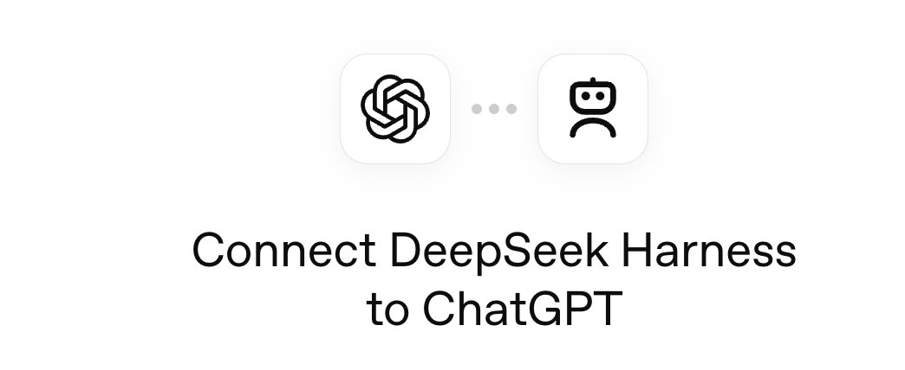
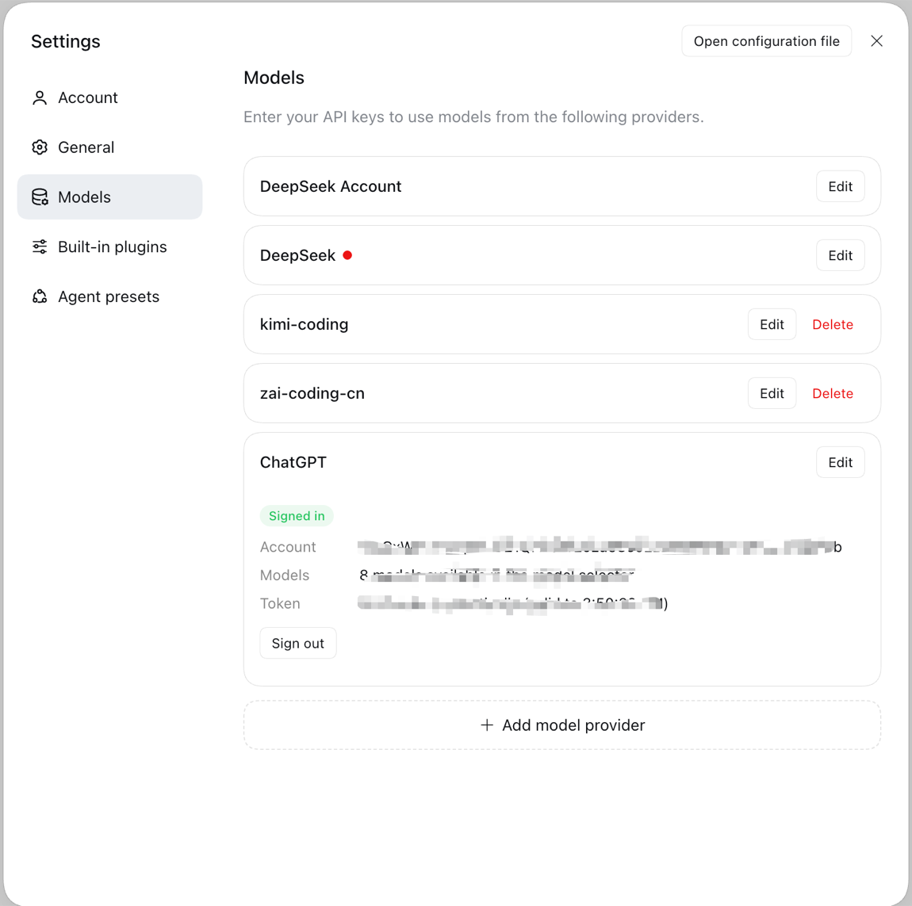
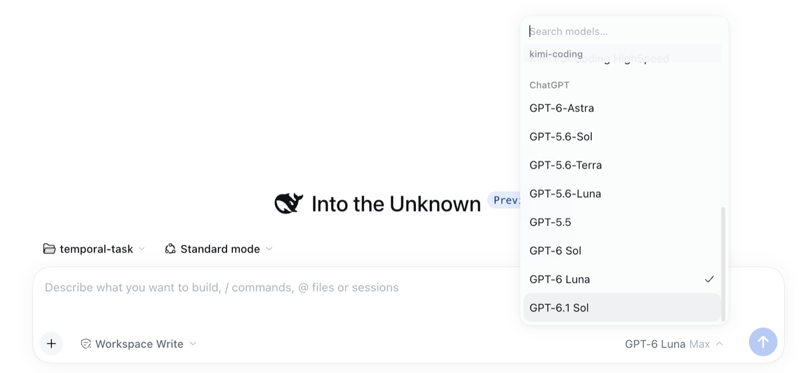
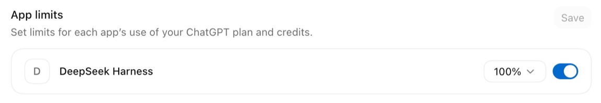

# dsh-plugin-chatgpt

[English](../README.md) | 中文

为 DeepSeek Harness 增加一个 provider 路由 `chatgpt`，它用已登录的 ChatGPT 订阅而不是 API key 来应答模型调用。登录采用 OpenAI 公布的 *Sign in with ChatGPT* 流程，因此由账号自己的套餐为推理付费。路由命名为 `chatgpt` 而非 `openai`，因为内置的 pi-ai 插件已经占用了后者。模型及其上下文窗口与推理级别都来自你自己账号的列表，因此可选范围跟着套餐走，而不是一份写死的清单。



## Table of Contents

- [使用本包](#use-this-package)
- [你会得到什么](#what-you-get)
- [实现说明](#understand-the-implementation)
- [延伸阅读](#further-exploration)
- [模型体验](#model-experience)
- [已知限制与待办](#known-limitations-and-deferred-work)
- [开发者说明](#dev-note)

-----

<a id="use-this-package"></a>
## 使用本包

### 安装到 profile

安装就是一行：

```text
dsh plugin --profile <name> add dsh-plugin-chatgpt
```

装完重启 harness：profile 在启动时组合。卸载：

```text
dsh plugin --profile <name> remove dsh-plugin-chatgpt
```

该包已在 npm 上，因此从 registry 安装就是全部步骤，不涉及任何构建：

```text
dsh plugin --profile <name> add dsh-plugin-chatgpt@0.1.9   # pin a version, or omit it for the latest
```

改从仓库地址安装则会从源码构建，而 pnpm 在构建脚本被允许之前会拒绝 git 依赖：`add https://github.com/ckanner/dsh-plugin-chatgpt` 会以 `ERR_PNPM_GIT_DEP_PREPARE_NOT_ALLOWED` 失败，直到在 profile 的 `pnpm-workspace.yaml` 里把 `dsh-plugin-chatgpt` 加进 `onlyBuiltDependencies`。

本包声明了 `dsh.bundle`，因此添加它会把该 bundle 追加到 profile 的 `dsh.profile.bundles`，并把它的行插入到组合中。可以不启动就检查这一层：

```text
dsh --profile <name> --dump-config   # shows a "# == dsh-plugin-chatgpt" layer
```

没有声明 `dsh.bundle` 的包不会激活任何层，`dsh plugin` 只会给出警告。

### 登录

打开**设置 → 模型**。本插件拥有一行 **ChatGPT**，该行的卡片提供 **Sign in with ChatGPT**。卡片会显示授权 URL 并支持选中复制；当浏览器无法访问回环地址时，可以粘贴最终的回调 URL；完成后卡片报告该账号——套餐、token 下次刷新时间、以及它提供多少个模型——并提供 **Sign out** 按钮。任何 token 都不会到达页面。

退出登录会先在授权服务器撤销可再生会话，再清除本地凭据；若服务器未能确认，卡片会如实说明。



无头 harness 不需要浏览器，可以直接驱动同一个会话对象：

```js
import { ChatGptAuth } from 'dsh-plugin-chatgpt/src/auth/manager.ts'

const auth = new ChatGptAuth({
  stateDir: `${process.env.DSH_HOME ?? `${process.env.HOME}/.dsh`}/chatgpt-subscription`,
  agentNameHint: 'DeepSeek Harness',
})

const attempt = await auth.begin()
console.log('Open this URL in your browser:\n' + attempt.authorizationUrl)

// The browser redirects to the loopback listener this attempt bound. If the
// redirect cannot reach it — a headless host, or a blocked popup — paste the
// final URL back instead.
// await attempt.submit('<the full redirect URL from your browser>')

const credential = await attempt.result
auth.adopt(credential)
```

授权凭据以仅属主可读的权限存放在 `stateDir` 下。`attempt.submit()` 对格式错误或不匹配的值会拒绝，并让本次尝试保持存活，所以粘贴错了可以改正重试。

-----

<a id="what-you-get"></a>
## 你会得到什么

一个 provider 路由，像内置 provider 一样出现在 **设置 → 模型** 里，带有该账号有权使用的模型清单、上下文窗口和推理级别。在那里选中某个模型，就是把它放进模型选择器的方式，不涉及任何单独的挑选界面。

模型元数据来自账号列表。适配器默认采用标准上下文窗口，并以 272,000 token 为上限，让 DSH 更早压缩。可在插件配置中设置可选的 `contextWindowLimit` 调整预算；显式扩展不会超过目录声明的最大容量。登录仍在这一行的卡片上。



这个安装可以花掉的套餐份额是在 ChatGPT 设置里按应用单独设定的：



-----

<a id="understand-the-implementation"></a>
## 实现说明

<details>
<summary>实现细节 — 点击展开</summary>

| 源码 | 职责 |
|---|---|
| `cordis.patch.yml` | 配置层：插入一行，指明路由与状态目录。 |
| `src/index.ts` | 插件入口：持有适配器实例并注册路由。 |
| `src/auth/protocol.ts` | 所公布流程的精确端点、scope 与 loopback 规则。 |
| `src/auth/sign-in.ts` | 授权：loopback 监听与粘贴重定向 URL，两条路径并行竞争。 |
| `src/auth/manager.ts` | 已存凭据、当前账号，以及单飞刷新。 |
| `src/auth/store.ts` | 原子写、仅属主可读的凭据存储。 |
| `src/api/events.ts` | 解码 Responses 事件流及其失败形态。 |
| `src/convert/request.ts` | Harness 请求转 Responses 请求体，含该路由拒收的字段。 |
| `src/convert/harness.ts` | DSH 请求边界，含会话身份与回放元数据。 |
| `src/convert/replay.ts` | 原生输出校验及限定账号和模型的 DSH 回放封装。 |
| `src/convert/blocks.ts` | 线上事件转 Harness 的编号内容块。 |
| `src/api/client.ts` | 两次 HTTP 调用：列出模型、跑一轮。 |
| `src/models/describe.ts` | 可用性与容量，优先采用账号所报的值而非内置目录。 |
| `src/adapter.ts` | provider 契约面向 Harness 的那一半。 |

代码强制而非仅记录的三条规则：

- 请求绝不携带 `temperature`、`max_output_tokens`、`top_p`、`truncation` 等套餐额度路由拒收的字段。它们被显式列在 `REFUSED_FIELDS` 中，因此不会被误加回来。
- `response.completed` 是唯一成功的终态。没有它就以结束的流算作错误，因为「被截断却看起来已完成」的回答比一个可见的失败更糟。
- **运行时读取账号元数据。** 插件使用当前账号的授权请求 `GET /v1/models`。内置目录补充缺失的描述，带测量日期的清单可加入未列出的模型。模型可用性、容量和报告给 DSH 的上下文预算是不同的概念。

</details>

-----

<a id="further-exploration"></a>
## 延伸阅读

- [Sign in with ChatGPT: OSS token sharing](https://developers.openai.com/siwc/token-sharing-open-source) — 本包所实现的公开流程。
- [Models and inference](https://developers.openai.com/siwc/token-sharing-open-source/models-and-inference) — 列表与请求约束。
- [Preview limitations](https://developers.openai.com/siwc/token-sharing-open-source/preview-limitations) — 该路由目前尚不具备的能力。

-----

<a id="model-experience"></a>
## 模型体验

本 bundle 只插入一行 provider，该行的插件拥有全部面向模型的行为；配置层本身不贡献任何 prompt、工具或上下文。

### 请求上下文与条件

#### 模型能看到什么

每轮发往 `chatgpt` 的请求都保留消息、助手内容块、工具调用及结果的原始顺序。system 与 developer 指令在原位置作为 developer 消息发送，并向 DSH 声明在历史中追加系统提示更新。助手的原生输出（含加密推理）通过 DSH 的 `replayState` 保存；账号、路由、模型一致且内容未变化时，完整回放这些数据。

#### Token 影响

可变。可见上下文来自 DSH；回放加密推理也可能计入输入 token，可读的思考摘要不能替代它。适配器不自行截断历史，由 DSH 按报告的上下文预算执行压缩。输出预留保持低于该预算，但这条路由不接受输出 token 上限。

#### KV Cache 影响

适配器在多轮工具调用和会话恢复中保留可复用前缀及不透明推理状态。账号注册、端点、provider、会话 ID 和调用用途的固定长度哈希同时用于 `prompt_cache_key` 与 `session_id` 请求头；刷新 token 不改变它，无会话 ID 的调用则省略两者。GPT-5.6 及以后由 OpenAI 自动处理缓存路由，key 不保证命中。SIWC 要求 `store: false` 并在 HTTP 请求中携带完整历史，响应存储与提示词缓存是两件事。与 Pi 的公共 SIWC 路线一样，这里继续省略缓存保留期与 options，等待按模型和路由验证。参见[官方缓存指南](https://developers.openai.com/api/docs/guides/prompt-caching)及[推理回放说明](https://developers.openai.com/api/docs/guides/reasoning#preserve-reasoning-without-stored-responses)。

## 已知限制与待办

- **已有历史仍可使用** — 旧会话缺失的加密回放数据无法恢复，但可见消息和工具记录会按顺序回放。对于被编辑、裁剪、来自其他适配器、格式错误或不兼容的元数据，会退回可见历史，避免重新引入已丢弃内容。此集成要求 DSH 宿主支持 `finish.replayState` 和 `systemPromptUpdate: "in-history"`；参见[回放设计与验证方案](cache-replay.md)。

- **UI 一次只展示一个账号** — 宿主为每个已授权账号分别保存，并可按 subject 退出其中任一个，但卡片只显示与切换当前账号，因此添加第二个账号需要先退出当前账号。
- **图片与文件不会被发送** — 图片或文件块携带的是持久化的附件引用，本适配器尚未解析它，因此到达模型时是占位文本 `[image omitted: not yet supported]`。该省略是可见的而非静默的，但内容确实丢失了。
- **套餐额度路由仍处于 preview** — computer use、Code Interpreter、file search、hosted MCP、图像生成与 `tool_search` 无论本插件发送什么都会被上游拒绝；而 `multi_agent`、`temperature` 和 `max_output_tokens` 属于必须省略的十五个字段之列。
- **名单混合了两个权威性不同的来源** — 账号的列表提供「被宣传的」模型，并附带接口自己的元数据；实测可用但列表未提及的模型来自 `src/models/served.ts`，并记录测量日期。若列表在测量过期后发生变化，会显示出已经不再应答的额外模型；`includeUnlisted: false` 可把名单收窄为账号自己的回答。
- **一个安装对应一个 host id** — host id 以状态目录为作用域。两个 profile 共用一个目录，对 OpenAI 而言就是一个安装；两个目录就是两个，各自需要单独授权。
- **`agent_name_hint` 是常量** — 默认 `DeepSeek Harness`，可按 profile 覆盖；但它是人类在授权页上读到的名字，也是 OpenAI 记录的此应用身份，因此改动它会改变既有授权凭据的归属。

- **上下文增长受可配置预算约束** — 默认取账号标准窗口与 272,000 token 中的较小值。`contextWindowLimit` 必须是至少 1,024 的整数；显式配置可启用扩展窗口，但不超过目录声明的最大值。实际触发点与预留空间仍由 DSH 的压缩策略控制。这是上下文预算，不是消费硬上限或缓存命中目标。

- **退出登录是两件事，卡片会说明发生了哪一件** — 可再生会话会先在授权服务器撤销，再清除本机凭据，因为本地删除的授权凭据可能在别处仍然有效。服务器无法送达时，本地登出仍然完成，而结果会明确说明远端撤销未被确认。额度耗尽时会指向 ChatGPT 自己的用量页面，并说明该错误码既不指明原因、也不给出重置时间：套餐的共享用量与应用级限制都可能是原因，因此网站上看起来远未接近上限的套餐与一次拒绝可以同时为真。

- **每个 Config 字段都是 `volatile()`，这是有实际作用的** — Harness 只根据 volatile 字段构建插件的 settings 表单，没有 volatile 字段的插件就不会有 settings 命名空间。而模型页只为命名空间存在的行渲染 provider 行，所以没有 volatile 字段的 schema 会让这条路由、以及依附其上的卡片，根本无法显示。volatile 字段在使用处以 `.get()` 读取，而不是被当作值捕获。

- **客户端半会自己挂载它的 Remote 命名空间** — 打包的第三方插件无法自行访问 `ctx.remote.<namespace>`：Gateway 只从生成出来的 descriptor contribution 安装命名空间，而承载这些内容的包是在构建期按固定的 workspace 包列表生成的。没有任何机制为树外包生成它，生成器也未发布，因此本插件在 `src/remote-methods.ts` 里自行挂载该 contribution。有测试会读取控制器源码，在两边列表不一致时失败——因为只在一边新增方法，会在用户点击的瞬间才报错。

- **登录后会向浏览器通告新的模型清单** — 模型选择器会缓存宿主 catalog，只在宿主声明有变化时重载，因此在登录时把空清单填满的插件必须发布 `llm/adapters-updated`。否则模型确实在服务，却永远不会出现在选择器里——看起来就像 provider 坏了。账号卡片会报告该账号提供多少个模型，或说明清单为何读不到。

- **缓存统计来自实测，不作预测** — 百分比按服务端计数计算为 `cacheReadTokens / (inputTokens + cacheReadTokens + cacheWriteTokens)`。旧版本曾重排工具历史并丢弃原生推理，其低命中率不能证明 SIWC 存在固有上限。前缀保持测试不等于线上命中率测试；应固定模型与推理级别，预热后比较缓存读写、总输入、延迟和额度影响。

- **每个安装各自注册一个 client** — ChatGPT 设置里每个注册对应一行应用，名称取自 `agent_name_hint`；本插件在登出后仍保留「账号 ↔ client」的映射，因此同一安装下次登录会复用原来那一行，而不是再添一行。第二个 state 目录对 OpenAI 而言就是第二个安装，会单独注册；删除某个 state 目录即等于忘记那个安装。

## Dev Note

```text
npm test          # node --test, no build step
npm run typecheck # entry point checked against dev-types/ shims
npm run build     # tsc emits the host half and the declarations, esbuild the browser bundle
npm run verify:harness -- /path/to/deepseek-harness # actual DSH assembler, offline
```

`dev-types/` 存放 Harness 的 LLM 与 Cordis 接缝的开发期声明，转录自 Harness 源码。它们不发布、也从不随包分发；宿主以 peer dependency 的形式提供真实包。在真实 Harness 中做端到端挂载仍然是权威的验证方式。

当上游目录更新时，重新生成模型目录：

```text
node scripts/generate-model-catalog.mjs /path/to/@earendil-works/pi-ai
```
