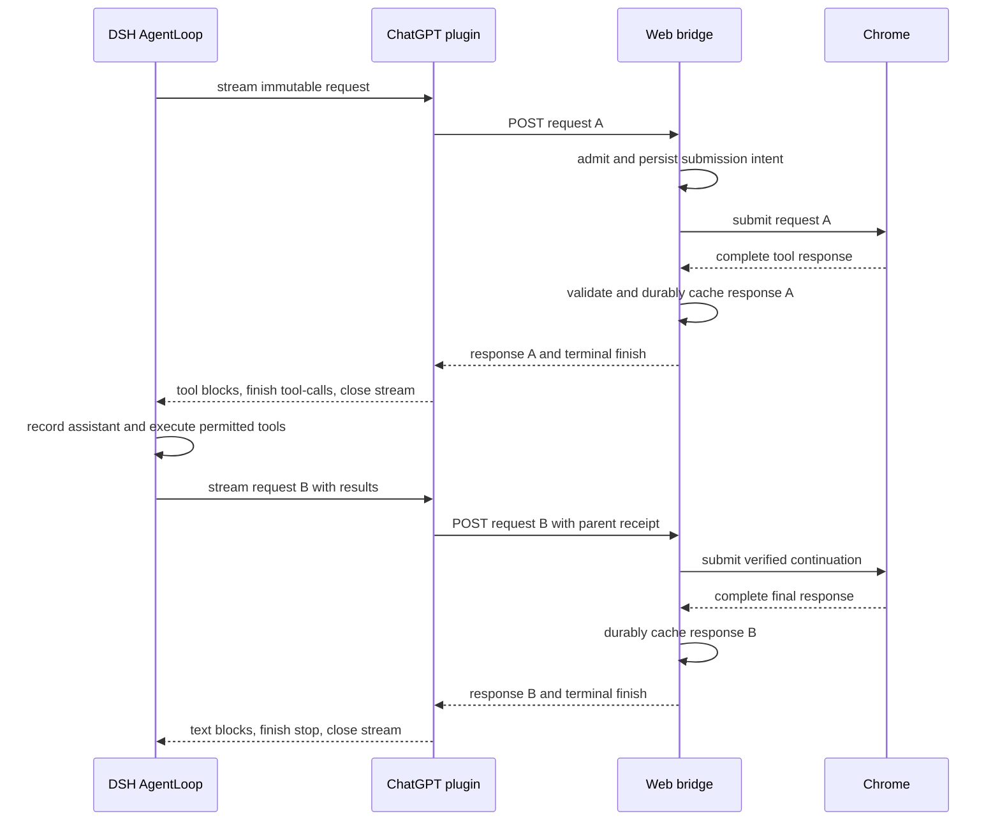
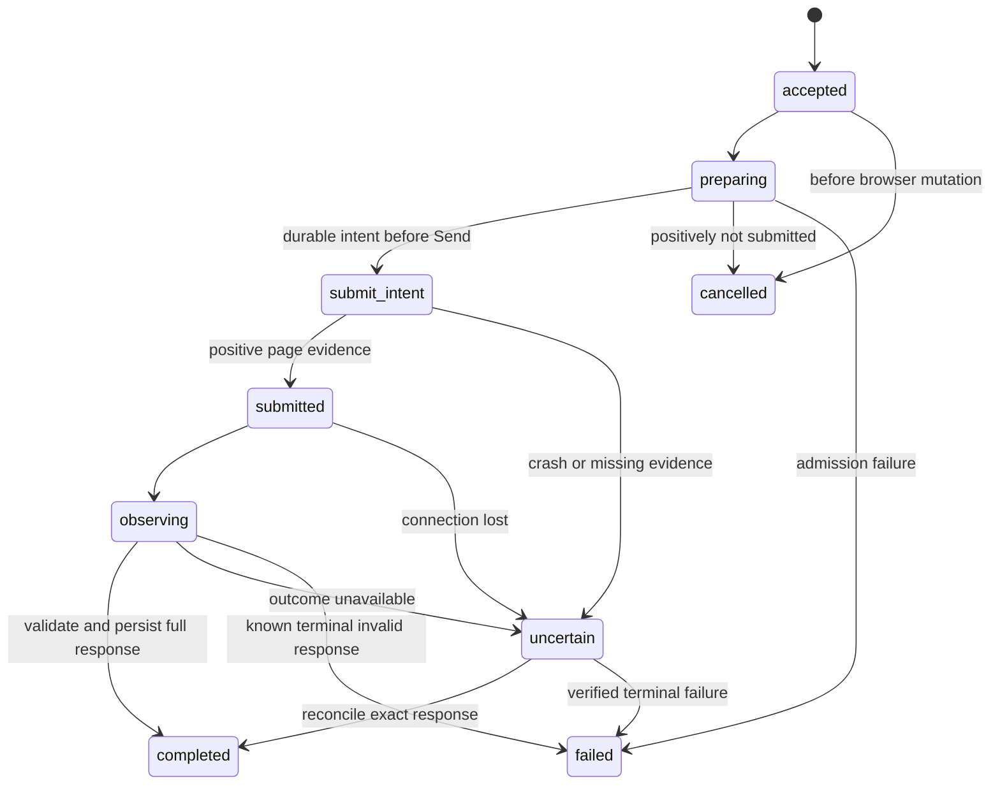

# ChatGPT Web Pro: local sidecar provider design

English | [中文](chatgpt-web-sidecar.zh.md)

Status: **proposed architecture, revised after source review**. This is a
design-only PR; the bridge and its acceptance tests are not implemented here.
It supersedes [chatgpt #9](https://github.com/ckanner/dsh-plugin-chatgpt/pull/9)
and [flywheel #57](https://github.com/ckanner/flywheel/pull/57), both closed
without merging. No DSH source modification is part of this design.

## 1. Decision

Implement Web Pro through the existing `chatgpt` provider and a local
`chatgpt-web-bridge` process. The plugin uses the public
`ctx.llm.registerAdapter()` API; the bridge owns Chrome, the dedicated profile,
the website protocol, request journal and provider-side recovery.

DSH owns the agent loop, authoritative history, tools, permissions and
compaction. The bridge can make its own submissions durable and idempotent; it
cannot promise a host acknowledgement, exactly-once local tools, or a veto on
other providers.

The Web model remains **GPT-6 Pro**:
`chatgpt / gpt-6-pro-web / pro`. GPT-6.2 Astra/Sol and UltraFast remain SIWC
features. Existing SIWC authentication, catalog and request behavior are
preserved; Web login and receipts have their own namespace.

### Review basis

The contracts below were checked against the unmodified upstream
[DSH source](https://github.com/deepseek-ai/deepseek-harness/tree/2e39e70496aa02986ca6a820c5d497e816b69d7e),
the [ChatGPT plugin base](https://github.com/ckanner/dsh-plugin-chatgpt/tree/afec4caef1dd4a55926e5de29ccb992be63fd7d9)
and [Flywheel main](https://github.com/ckanner/flywheel/tree/f016015a884351d081e066a4031a6814299f25e5).
Source links identify review evidence, not a runtime host-tree pin. The
released DSH `0.2.2-rc.5` tag is `9c2670d3bce5275e0d1610272958121af87787bb`;
it is a separate tree and must be included in implementation acceptance.
A declared 0.2/0.3 peer range is not evidence that every release has been tested.

## 2. Why the host patch is rejected

The previous candidate added durable response acknowledgement, replay veto,
summary-route metadata and recovered-response adoption by patching DSH source.
That required users to replace the desktop/SDK host and maintain an exact
source patch across upgrades. It did not satisfy the distributable-plugin goal.

Stock DSH already has its own
[session checkpoint policy](https://github.com/deepseek-ai/deepseek-harness/blob/2e39e70496aa02986ca6a820c5d497e816b69d7e/packages/session/session-checkpoint-policy/src/index.ts):
it flushes logged requests and top-level tool intents before dispatch when
installed by the normal host composition. This is DSH's durability boundary.
A bridge receipt is a different fact and does not acknowledge that boundary.

The replacement keeps provider durability in the bridge and uses only public
plugin interfaces. It does not reproduce the old host hooks in a hidden shim.

## 3. Architecture and ownership

The stock DSH adapter calls a local authenticated bridge over loopback HTTP.
The bridge drives the website through its own Chrome profile.

| Owner | Responsibility |
| --- | --- |
| DSH | Session history, AgentLoop, tools, permissions, compaction, retry policy and host checkpoints |
| `chatgpt` plugin | Provider/model metadata, attachment resolution, exact request normalization, bridge client, `StreamChunk` mapping and settings |
| bridge | Profile/account binding, serialized browser actions, page protocol, journal, response cache and Web-request fences |
| Flywheel | Its SDK invocation, task/role/candidate evidence, budgets, orchestration and any consumer recovery policy |
| Chrome profile | Website login and bridge-owned chats; no copied DSH credentials |

The bridge never executes DSH tools. A successful model response, a delivered
tool call, a tool result and a completed Flywheel task are separate facts.

## 4. End-to-end interaction

A **provider request** is one finite model response. A **browser conversation**
may contain many such requests. A tool continuation is a new provider request
and a new browser submission in the same verified conversation.



The [stock AgentLoop](https://github.com/deepseek-ai/deepseek-harness/blob/2e39e70496aa02986ca6a820c5d497e816b69d7e/packages/core/agent-loop/src/agent.ts)
consumes the entire stream, records the assistant, then executes tools.
Therefore **every tool-call response must finish and close before waiting for
tool results**. The bridge releases the browser mutation slot at that boundary;
it does not hold a stream or profile queue slot while DSH runs local tools.

## 5. Request identity and idempotency

### 5.1 Identity comes from the admitted request snapshot

The public
[`GenerateOptions` and `RequestMessage`](https://github.com/deepseek-ai/deepseek-harness/blob/2e39e70496aa02986ca6a820c5d497e816b69d7e/packages/llm/llm/src/types.ts)
allow `system`, optional `sessionId`/`purpose`, durable messages with stable
IDs, and identity-free one-shot inputs. The plugin must preserve these
distinctions. It must not read the live session's latest `user/message` seq to
invent a request identity: that event can differ from an asynchronous request's
input, and retries can rebuild context or compact history.

The plugin detaches an immutable GenerateOptions snapshot before asynchronous
attachment or bridge work. It resolves exact attachment versions and obtains
the authenticated bridge's durable installation/profile/account binding from
that snapshot, then finalizes the wire envelope/hash before admission. It never
rereads mutable caller input. The binding is checked again before mutation.

```text
binding = {
  protocolVersion, installationId, providerRoute,
  profileId, accountBinding, sessionId, purpose
}
anchor = identities from this request's admitted input
payload = normalize(model, reasoningEffort, system, ordered messages, tools,
                    controls, attachment versions, parentReceipt)
requestHash = sha256(canonical({ binding, anchor, payload }))
idempotencyKey = requestHash
```

Canonicalization uses sorted object keys, ordered arrays and unambiguous typed
serialization. It preserves effective system/developer instructions, tool
schemas and results, model/effort, meaningful controls and image byte digests.
Signals, temporary ports, launch tokens, client leases, delivery attempts and
transport timestamps are excluded from the semantic request hash.
The bridge independently recomputes the hash; same key with a different
envelope is a conflict. The parent receipt must also match the receipt derived
from the hashed assistant history before admission or cache lookup.

| Request | Anchor and admission |
| --- | --- |
| Normal AgentLoop | Required session ID and stable message IDs from the supplied request; include the full effective body because a surface replacement can change content |
| Compaction | Existing source-message IDs plus purpose and full summary input; the appended summary instruction may legitimately have no ID |
| Session title | Session/purpose plus the semantic title input, system and controls; ignore the producer's freshly generated wrapper UUID for this purpose only |
| Identity-free normal one-shot | Reject before browser action in v1; do not use an empty session, random retry key or another request's live user event |

For titles, identical semantic input intentionally addresses the same cached
work. A later title producer invocation is not evidence of the original
request's consumption. For all purposes, only supported caller shapes are
admitted; additional one-shot support needs an explicit durable operation
identity and separate contract tests.

### 5.2 The guarantee and its limits

The bridge guarantees **at most one submission for an admitted exact request
identity**. It cannot identify every semantic retry after DSH changes the
request, compacts history, forks or creates a new session. Changed input must
not be silently labeled the same logical operation.

Every key, including a new one, first passes the persisted profile and
conversation admission checks. An unresolved submission intent or browser
outcome fences further submissions on that profile, including another DSH
session. A model, effort, account or profile change does not automatically
resolve an old record. Explicit inspection/reconciliation is required.

The same pending key attaches to its existing work; completed text can be
replayed from cache. Tool-bearing responses have the stricter delivery rules
in §8. These fences govern Web requests through this bridge, not SIWC, another
bridge installation, other providers or arbitrary local tools.

## 6. Bridge API

Version 1 binds `127.0.0.1` on an ephemeral port. All endpoints require the
private per-launch bearer token. An authenticated health/admission response
identifies the instance, protocol version and current profile/account binding;
absence of a verified binding requires setup, not a model submission.

### One finite request

```http
POST /v1/turns
Authorization: Bearer <launch-token>
Content-Type: application/json
Accept: text/event-stream
```

A schematic, valid JSON request:

```json
{
  "protocolVersion": 1,
  "clientLeaseId": "client-lease",
  "deliveryAttemptId": "delivery-attempt",
  "idempotencyKey": "sha256:request-digest",
  "installationId": "bridge-installation",
  "provider": "chatgpt",
  "profileId": "dedicated-profile",
  "accountBinding": "verified-account-fingerprint",
  "sessionId": "session-id",
  "purpose": "normal",
  "model": "gpt-6-pro-web",
  "reasoningEffort": "pro",
  "system": "Effective out-of-band instructions, when supplied",
  "messages": [
    {
      "id": "durable-message-id",
      "role": "user",
      "content": [{ "type": "text", "text": "Inspect the requested file." }]
    }
  ],
  "tools": [],
  "controls": {},
  "attachmentVersions": [],
  "parentReceipt": null
}
```

`purpose` is normalized to `normal` only when absent; recognized auxiliary
protocol purposes are `compaction` and `session-title`. Recognizing a purpose
does not establish that its requested controls are supported. Unsupported
purposes or request options fail before browser action. Client lease and
delivery-attempt IDs control response ownership; they do not create a new model
request identity.

The plugin forwards `GenerateOptions.system` using the same precedence as
the existing [request converter](../../src/convert/request.ts); effective
instructions must participate in hashing and transmission. It must not drop
them just because they are not a leading message. Supported generation
controls are normalized into `controls` and hashed. Controls the website
cannot faithfully implement are rejected, not silently omitted or described
as provider-enforced limits; §9 covers summarizer output caps.

Images are resolved through the public attachment service to the exact
request-version bytes. The API carries validated MIME, length and digest with
inline bytes or a bridge-owned, digest-checked blob reference. It does not
accept an arbitrary local path or silently substitute an attachment label.
Unsupported file blocks fail before upload.

### Response events and host mapping

SSE uses normal `event:` and `data:` lines separated by a blank line:

```text
event: turn
data: {"turnId":"request-a","state":"accepted"}

event: finish
data: {"turnId":"request-a","reason":"tool-calls","responseDigest":"sha256:response","state":"completed"}

```

This excerpt omits the response payload. The versioned response schema must
carry the complete validated text/tool blocks, stable call IDs and receipt;
`finish` alone is not a response. V1 buffers and validates the complete page
envelope before exposing executable tool blocks. Observed progress events
are separate from model content and cannot fabricate reasoning or usage.

The plugin maps a validated response to public `block-start`, deltas,
`block-end` and terminal `finish` chunks. Tool output ends with
`reason: { kind: 'tool-calls' }`; final text ends with
`reason: { kind: 'stop' }`, then the generator closes. No success chunks
follow finish. Usage is omitted when unobserved.

A bridge `WEB_UNCERTAIN` error is mapped to a structured public LLM failure
and a visible recovery instruction. `retryable: false` in bridge JSON is
not a host replay veto: stock retry policy operates on codes. The bridge
must enforce its fence on every subsequent request even if the host retries
the error or the consumer maps it to a generic code.

### Control

```text
GET  /v1/turns/:turnId
POST /v1/turns/:turnId/cancel
POST /v1/turns/:turnId/recover
POST /v1/turns/:turnId/discard
POST /v1/clients
POST /v1/clients/:clientId/heartbeat
DELETE /v1/clients/:clientId
GET  /health
```

`recover` performs authenticated read-only journal/page reconciliation and
returns evidence or a completed cached response; it never resubmits, runs
tools or writes DSH history. `discard` records an explicit decision and keeps
a tombstone. It is not permission to rerun a tool or proof that a remote
generation stopped; an active/unknown browser still keeps its profile fenced.
Control requests validate the caller's installation, session and turn ownership.
Client registration grants a private lease; heartbeats maintain only that
client's ownership, not evidence of model activity. Release affects only that
lease. The implementation contract must bound expiry and reject stale leases.

## 7. Request state machine and durability



At minimum the journal records:

```text
schemaVersion, bridgeInstanceId, installationId, profileId, accountBinding
turnId, idempotencyKey, requestHash, sessionId, purpose, model, effort
generationId, projectId, conversationId, conversationUrl, parentReceipt
normalizedRequest, attachmentDigests, submissionIntent, observedPromptId
completeResponse, responseDigest, stableToolCalls, deliveryOwner, deliveryState, state
createdAt, updatedAt, lastObservedAt, fenceReason
```

Rules:

- Acquire the profile/record lock, validate binding and persist admission.
- **Atomically write and fsync `submit_intent` before any Send action.**
  If the process dies after the click but before `submitted`, restart observes
  the intent and reconciles; it cannot return to a sendable `preparing` state.
- Project creation, uploads and cleanup also record their own mutation intent
  and observed identity; an ambiguous setup action is not blindly repeated.
- Persist and flush the full validated response, tool IDs and digest before
  emitting successful model content or finish. No quota/time/error page or
  stable partial text is a completed answer.
- Journal durability includes atomic replacement and the necessary file and
  parent-directory sync. For an existing installation, corruption, missing
  evidence or a lost journal causes admission failure, not an empty fresh
  registry. First installation creates its identity/store through explicit setup.
- Submission cancellation is `uncertain` until page evidence proves its
  outcome. Closing HTTP or terminating Chrome does not prove the website stopped.
- Concurrent same-key callers join one browser operation, but this does not grant
  every subscriber executable response delivery (§8). Different keys cannot
  pass an unresolved profile fence. Browser mutation is serialized per physical profile.
- Completed model response and host delivery are separate state. Tool-response
  exposure is persisted before its first executable chunk; see §8.
- `failed`, `cancelled` and `discarded` retain identity/tombstones. A new
  operation requires explicit admissible input; it never resets a prior key.

## 8. Tool loop, receipts and recovery limits

The page receives a strict versioned envelope containing only the admitted
tool schemas. The bridge validates the entire response, exact names, JSON
arguments and call IDs before mapping it into DSH blocks. It does not widen
permissions, run tools, or treat prose as a tool result.

Every model response, including a tool-call response, is a separately completed
provider request. Stable call IDs are namespaced to that response; duplicate
IDs within it fail. Later history may legitimately contain a different
response with a reused short website ID, so continuation checks use the parent
receipt and call occurrence, not a global short-ID comparison.

The public
[`finish.replayState`](https://github.com/deepseek-ai/deepseek-harness/blob/2e39e70496aa02986ca6a820c5d497e816b69d7e/packages/llm/llm/src/types.ts)
can carry an adapter-private receipt in `ReplayEnvelope.response`:

```json
{
  "kind": "chatgpt-web-receipt",
  "version": 1,
  "installationId": "bridge-installation",
  "provider": "chatgpt",
  "profileId": "dedicated-profile",
  "accountBinding": "verified-account-fingerprint",
  "sessionId": "session-id",
  "purpose": "normal",
  "model": "gpt-6-pro-web",
  "generationId": "generation-id",
  "turnId": "request-a",
  "requestHash": "sha256:request",
  "responseDigest": "sha256:response"
}
```

DSH may store it on the assistant's source and return it in a later request.
The bridge validates it against its journal, current session/generation,
exact assistant blocks and ordered tool results. A copied/forked receipt,
another account or a changed prefix cannot adopt an old request.

SIWC and Web share an adapter, so host filtering alone does not isolate their
opaque state. Each branch recognizes only its own kind/version/route/model/
account scope; foreign opaque SIWC state never becomes a Web instruction or
receipt.

### Tool delivery boundary

DSH owns permission decisions, tool execution and result durability. The
ordinary adapter request does not supply a universal typed proof of tool
execution/unknown outcome; `isError` and error prose are not such proof.

V1 persists `delivery-intent` before exposing a tool-bearing response.
An atomic durable claim grants exactly one `clientLeaseId + deliveryAttemptId`
the first delivery. Other same-key subscribers receive status/inspection only,
never a second executable copy. Losing that owner does not automatically transfer
the claim; it enters inspection. Completed text-only responses may be shared.
After exposure might have occurred, **a later provider retry does not
automatically emit that cached tool response again**. It either recognizes a
valid continuation with the parent receipt and the full matching result set,
or requires explicit inspection. Missing, partial or conflicting results do
not authorize another tool invocation. An uninterrupted first delivery is the
normal supported path; more permissive reconnect needs its own proof/tests.

A receipt proves what the bridge recorded. It does not prove host fsync,
tool success, safe tool replay or Flywheel task completion. The bridge does
not install a global DSH tool fence. Normal stock checkpoint behavior remains
DSH-owned, and custom host compositions must verify their own policy.

## 9. History projection, compaction and titles

### 9.1 Keep the website aligned with the current DSH request

DSH's request surface is authoritative. The bridge stores a binding for
`installation/account/profile/session/purpose/generation` plus the exact
projected prefix and receipt chain.

Only an exact, verified append to that prefix can use a delta in the existing
conversation. Compaction, fork, history replacement, changed effective
instructions/tools or unverified page edits require a fresh generation seeded
from the **current** request. The bridge does not append an entire rewritten
history to an old chat, silently truncate input, or maintain its own summary.

A fresh generation uses a new empty private **project-only Project and chat**,
not just another chat in the old Project. OpenAI documents that
[project-only memory can reference other conversations in the same Project](https://help.openai.com/en/articles/10169521-projects-in-chatgpt).
Thus reusing that Project could reintroduce history DSH removed.
Old generations remain inspectable evidence; they are not copied into the new
Project or automatically deleted.

Before input or upload, verify the actual account, project, conversation,
GPT-6/Pro controls and absence of an interfering generation/hosted app mode.
Recheck after uploads and immediately before sending. A matching URL alone is
insufficient. If isolation or context fit cannot be established, fail before
submission; do not let website-side history trimming masquerade as DSH compaction.

### 9.2 Auxiliary requests

For `purpose: compaction`, use a separate purpose-specific Project, prohibit
tool execution and return validated text only. The host may supply historical
tool schemas for prefix alignment; these are hashed as input but are never
active tools for the summary response. A failed/truncated summary does not
replace DSH history.

The public stock summarizer can use its configured provider/model. Keep that
routing decision in DSH. Website input/output limits must be explicit:
a requested `maxTokens`, `temperature` or `stop` is not automatically a
website capability. Unsupported enforcement fails with a clear option error.
The stock summary producer always supplies `maxTokens`; the stock title
producer also supplies an output cap. Before enabling long Web sessions while
Web control enforcement remains unproved, setup must check an explicit supported
summary provider/model in the existing DSH settings. Model-backed titles likewise
need an explicit supported route, or the optional title feature remains disabled.
Do not silently switch routes or count their default fallback to the Web model
as a supported configuration. Web-backed auxiliary requests are accepted only
after their option semantics and overflow behavior are proved. Unknown usage
never becomes a zero count or a hard token-budget guarantee.

`session-title` is optional, text-only, separately scoped and content-addressed
as described in §5. It must not select a newer live user event, execute tools,
pollute the task Project or imply that a newly generated title request is a
retry of an older UUID.

## 10. Model selection and metadata

Keep the existing provider and add the explicit Web model when enabled and
the bridge is ready:

```text
provider: chatgpt
model: gpt-6-pro-web
label: GPT-6 Pro · Web
reasoning.efforts: [pro]
reasoning.defaultEffort: pro
```

The public `resolveModel(provider, model, signal?)` receives no effort
argument. It resolves the exact model and advertises the supported reasoning
metadata; stock call resolution validates the requested effort. The plugin and
bridge also validate the actual model/effort at dispatch and before Send.
Unsupported selections fail instead of being silently changed.

Catalog health controls visibility, not the sole admission gate. A previously
configured model must fail clearly when login or the bridge is unavailable.
The SIWC roster continues to come from its account catalog, with independent
authentication and failure behavior.

## 11. Security and privacy

- Authenticate every bridge endpoint, including status/recovery; do not log tokens.
- Enforce literal loopback endpoints, validate Host/Origin, disable permissive
  CORS and redirects, and bound request/event/image sizes. `bridgeUrl` cannot
  turn this local transport into an unreviewed remote service.
- Use owner-only profile, journal and handshake directories (0700) and files
  (0600). Protect request/response contents as sensitive local data.
- Bind the profile lock to its canonical physical path and OS user. Verify
  handshake instance identity; a stale PID/port alone does not establish ownership.
- Keep CDP on loopback or a private pipe; reuse only bridge-owned Chrome.
  Never attach to or kill an arbitrary user browser.
- Resolve only explicit request attachments through the public host service;
  arbitrary file reads or unrestricted URL fetching are not a bridge API.
- Website/model text is untrusted. It cannot add a tool, raise permissions,
  change the selected account or authenticate a recovery operation.
- Login is a visible user action in the dedicated profile. No DSH or SIWC
  credential is copied into Chrome, and setup does not silently change account
  memory/privacy settings.

## 12. Process lifecycle and installation

V1 bundles the TypeScript bridge runtime in the plugin package. Installation
uses the normal plugin flow plus explicit login/setup; no application or DSH
package is replaced. A separately managed bridge is optional, authenticated,
local-only and protocol-version checked.

One physical profile has one bridge service with a lifetime independent of
the first plugin client:

1. Atomically discover/start under the profile ownership lock. Validate the
   private handshake, instance ID, protocol and binding before joining.
2. Each Desktop/SDK client holds its own lease and request ownership. A later
   client must not be treated as a child of the original launcher.
3. Plugin disposal releases its lease and cancels only its requests. It does
   not kill a shared bridge or another client's generation.
4. The bridge may stop under a documented idle policy only after no client
   leases or active work remain. Persist/reconcile uncertain work first.
5. Cleanup touches only the Chrome process group the bridge created and can
   still identify. External bridge lifetime belongs to its external owner.

An explicit trusted `bridgeCommand` uses an executable and argument array,
not an interpolated shell string. The managed package and protocol versions
are verified at startup. Replacing a lost journal or profile is an explicit
recovery operation; automatic restart never creates a blank evidence store
and treats old work as new.

## 13. Failure matrix

| Failure | Result |
| --- | --- |
| Bridge absent before admission | Setup/transport failure; no browser action |
| Account/model/effort/option mismatch | Admission error before upload/input |
| Crash after durable intent, before submission acknowledgement | Uncertain; reconcile, never blindly Send again |
| Page connection lost after submission | Profile fenced until exact outcome is established |
| Same key and envelope | Join existing work or replay admissible cached text |
| Same key, different envelope | Conflict; no mutation |
| New key while profile outcome is uncertain | Fenced too; session/model changes cannot bypass it |
| Cancellation with positive proof of no submission | Cancelled with evidence; no replacement |
| Cancellation after intent/submission | Uncertain until reconciled |
| Malformed/partial/error-page response | No successful text/tool response; preserve submitted evidence |
| Tool response may have been delivered; result missing | Inspection required; no automatic tool-response replay |
| Summary/title failure or unsupported controls | Host retains its history; no fallback rewrite by the bridge |
| Launching Desktop exits while another SDK client is active | Release only that client's lease; keep the shared service alive |

## 14. Testing and acceptance

These are **planned gates**, not results established by this design PR.

### Unit and protocol

- Exact-envelope hashing includes out-of-band system instructions, controls,
  account/profile/provider identity and exact image versions.
- Stable normal inputs, compaction's identity-free trailing instruction,
  content-addressed titles and rejection of anonymous normal calls.
- Same-key conflict, concurrent duplicate requests and a new key/session while
  a profile is fenced.
- Two same-key consumers can cause only one browser submission and only one
  executable tool-response delivery; owner loss cannot transfer that delivery.
- Fault injection before/after every journal write, fsync, Send, response cache
  and tool-delivery intent; no duplicate send or automatic executable replay.
- Complete SSE/StreamChunk termination, validated blocks and stable tool IDs;
  no partial response promoted to success.
- Receipt validation across forks, copied sessions, account changes and SIWC/Web.
- New generation after compaction/history drift, including Project-level
  isolation; attachment replay uses the exact request bytes.
- Two-client startup/disposal races, stale handshake, crashed owner, authentication
  and bounded input.

### Integration on an unmodified host

- Public adapter plus stock AgentLoop completes two model requests around one
  local tool execution; the first stream finishes before the tool starts.
- Stock checkpoint policy remains installed; no monkey patch or copied host source.
- Retry after runtime-context refresh/compaction exercises changed envelopes
  and fences instead of assuming the key is unchanged.
- Summary/title calls preserve `system` and use isolated purpose contexts;
  unsupported options fail without history loss.
- Response exposure, DSH restart, bridge restart and tool-result ambiguity are
  checked independently from browser submission recovery.
- Shared Desktop/SDK clients cannot terminate one another's work.

### Real acceptance

Use released stock DSH `0.2.2-rc.5`, install only the plugin/bridge, sign in,
select Web Pro, then verify text, tools, images, long history/generation changes,
cancellation, both restarts and multiple clients on macOS. Repeat the relevant
contract suite for each declared supported 0.2/0.3 release before claiming it
tested. Fixture Chrome and offline contracts do not establish signed-in
website behavior.

## 15. Migration and Flywheel integration

### Reuse from the rejected candidate

Keep #9/#57 closed and retain their branches/history. Extract reviewed CDP,
page verification, image, response parsing and cancellation code selectively.
Remove host-hook dependencies, old host-tree admission and global recovery
claims. Do not merge or release the old alpha archive as the new bridge.

Implement the public contract and crash tests before porting the browser.
The bundled bridge is the initial distribution decision; any future separate
package must preserve protocol and journal migration compatibility.

### Flywheel requires a separate integration PR

Flywheel can reuse `harness: dsh` and the ordinary `chatgpt` provider route.
That does **not** make its existing UI, policy or recovery Web-aware.
The [current main source](https://github.com/ckanner/flywheel/tree/f016015a884351d081e066a4031a6814299f25e5)
has the following concrete follow-up requirements:

| Boundary | Current behavior and required work |
| --- | --- |
| Exact model/effort | UI offers no new `pro` option; empty DSH thinking becomes `high`; execution-policy schema/validator rejects `pro`. Add and test the exact Web binding without changing unrelated provider defaults. |
| Web outcome | `WEB_UNCERTAIN` currently becomes a generic `SERVER`; an SDK `turn/end` error may become `failed`, and later work can use a new session. Preserve independent Web facts and enforce the appropriate admission fence. |
| Recovery | Current adapter-journal recovery is for Codex/Claude. Add reviewed Web inspection/recovery if required; a cached model answer is not a complete SDK task or candidate receipt. |
| Budget | Preserve missing usage as unknown. With an explicit daily token limit, hard-budget mode stops later calls after unknown usage; it cannot retrospectively measure a Web turn. Never substitute zero. |
| Compaction/title | The current SDK overlay disables these host plugins. Desktop acceptance is not evidence that Flywheel enables them; decide and verify its composition separately. |
| Liveness | Validate long Pro thinking/queue phases against actual watchdog deadlines. Only real observations can count as activity; daemon health is not model progress. |

Relevant current code:
[driver defaults](https://github.com/ckanner/flywheel/blob/f016015a884351d081e066a4031a6814299f25e5/internal/drivers/dsh.go),
[effort policy](https://github.com/ckanner/flywheel/blob/f016015a884351d081e066a4031a6814299f25e5/internal/config/execution_policy.go),
[SDK lifecycle/overlay](https://github.com/ckanner/flywheel/blob/f016015a884351d081e066a4031a6814299f25e5/plugins/dsh/src/bridge.js),
[error mapping](https://github.com/ckanner/flywheel/blob/f016015a884351d081e066a4031a6814299f25e5/plugins/dsh/src/protocol.js)
and [recovery entry](https://github.com/ckanner/flywheel/blob/f016015a884351d081e066a4031a6814299f25e5/internal/machine/session_recovery.go).

No bridge guarantee substitutes for Flywheel's task, workspace, permission,
candidate or other-provider controls. This design does not claim automatic
Web adoption or cross-provider tool fencing on the current main branch.

## 16. Disposition of existing pull requests

| Pull request | Disposition |
| --- | --- |
| [ChatGPT #9](https://github.com/ckanner/dsh-plugin-chatgpt/pull/9) | Closed, unmerged, superseded; preserve research evidence |
| [Flywheel #57](https://github.com/ckanner/flywheel/pull/57) | Closed, unmerged, superseded; do not ship its patched-host integration |
| [ChatGPT #10](https://github.com/ckanner/dsh-plugin-chatgpt/pull/10) | Merged; ordinary plugin DSH compatibility range |
| [ChatGPT #11](https://github.com/ckanner/dsh-plugin-chatgpt/pull/11) | Merged; SIWC GPT-6.2 metadata |
| [ChatGPT #12](https://github.com/ckanner/dsh-plugin-chatgpt/pull/12) | Merged; SIWC UltraFast variants |
| [ChatGPT #13](https://github.com/ckanner/dsh-plugin-chatgpt/pull/13) | Merged; display labels |
| [Flywheel #58](https://github.com/ckanner/flywheel/pull/58) | Merged; full conversation-page workbench |
| [Flywheel #59](https://github.com/ckanner/flywheel/pull/59) | Merged; compatibility window, main package version 0.37.3 |

These merged changes remain valid. Closing the old Web candidates does not
revert their independent SIWC, compatibility or UI work. Source versions and
merged status do not by themselves establish a registry installation test.

## 17. Delivery phases

1. **Design review** — this document and explicit stock-host boundaries.
2. **Contract and durability skeleton** — normalized API, journal, submission
   intent, fences, leases, mock page and thin client; crash/retry tests first.
3. **Text Web Pro** — real Chrome, login, isolation, model/Pro verification and
   finite text requests.
4. **Tool loop** — finite tool responses, receipt/result matching and conservative
   delivery recovery on stock DSH.
5. **Images and history** — exact bytes, projection/generation changes, stock
   compaction interaction and explicit auxiliary option support.
6. **Recovery and consumer integration** — admin inspection, multi-client
   restarts and the separate Flywheel contracts in §15.
7. **Live acceptance and release** — stock macOS Desktop, signed-in account,
   supported-version fixtures and the exact reviewed package.

Each phase has its own implementation PR. Submission durability is part of the
first executable contract, not postponed until a late recovery phase. None
modifies DSH source.

## 18. Decisions before implementation acceptance

- V1 uses TypeScript and bundles the bridge with the plugin; an optional
  external bridge is local-only and protocol checked.
- Identical admitted text requests may return cached responses; ambiguous
  tool-response delivery requires inspection.
- Web usage remains unknown unless directly observed. No fabricated token,
  cost, visual-consumption or hard-budget claim is allowed.
- Unsupported generation controls fail explicitly; Web summary/title routes
  require tested semantics before being advertised.
- Commands and the provider settings card expose status, inspect/recover and
  explicit discard with clear scope.
- Live selectors, context capacity, image behavior and Project isolation still
  require signed-in acceptance; this document does not certify them.

## 19. Acceptance criteria for this design

- The product installs into stock DSH through public APIs; no host patch or
  application replacement is required.
- Request identity refers to the supplied immutable input, preserving system
  instructions and exact attachment versions.
- Every admitted request has one durable submission identity; uncertainty
  fences new keys as well as retries on the affected profile.
- A tool response finishes before DSH executes tools; bridge cache/replay never
  claims host ACK or exactly-once tool execution.
- Compaction/history changes cannot silently reuse stale browser/Project context.
- Shared bridge lifetime is independent of the first client.
- Flywheel integration is separately specified and tested; old #9/#57 are not
  revived or used as evidence of the new architecture's acceptance.
