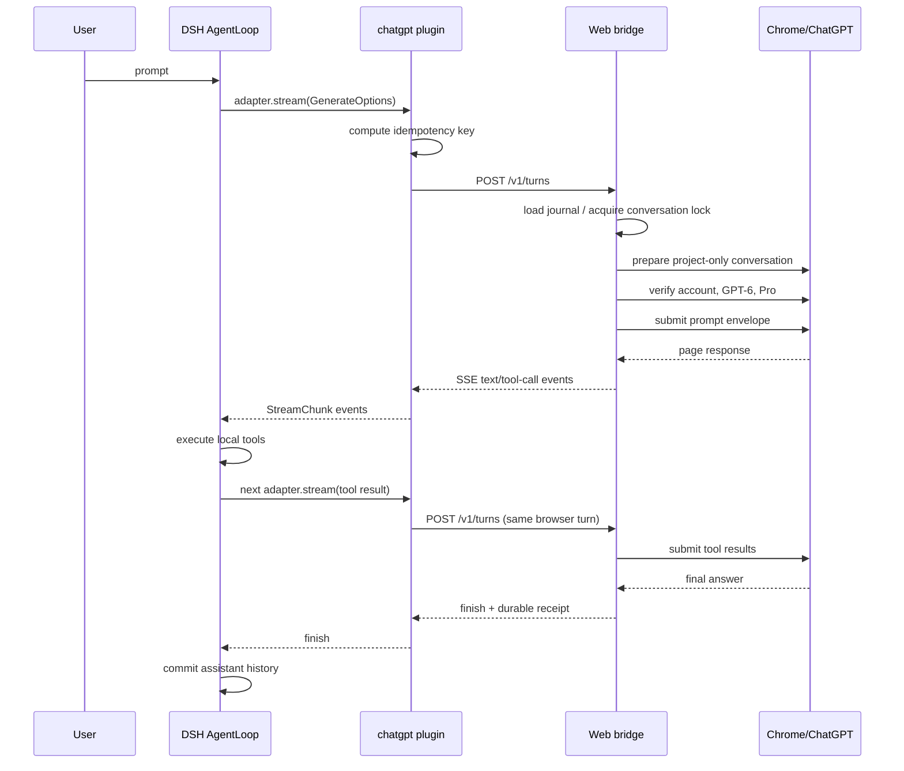

# ChatGPT Web Pro: local sidecar provider design

English | [中文](chatgpt-web-sidecar.zh.md)

Status: **proposed architecture**. This document supersedes the patched-DSH
approach in [chatgpt #9](https://github.com/ckanner/dsh-plugin-chatgpt/pull/9)
and [flywheel #57](https://github.com/ckanner/flywheel/pull/57). It does not
modify DSH source.

## 1. Decision

Implement Web Pro as two ordinary pieces:

1. the existing `chatgpt` DSH provider plugin, registering
   `gpt-6-pro-web` through the public `ctx.llm.registerAdapter()` API;
2. a local **ChatGPT Web bridge** process that owns Chrome, the browser profile,
   the web conversation, turn journalling, idempotency and recovery.

DSH remains an unmodified installation. The bridge is a provider-side runtime,
not a harness fork.

The model remains **GPT-6 Pro** only. GPT-6.2 Astra/Sol and UltraFast belong to
the SIWC provider and are not Web Pro models.

## 2. Why the host patch is rejected

The rejected candidate needed public host capabilities that stock DSH does not
provide: durable response acknowledgement, replay veto, summary-route metadata
and recovered-response adoption. It added those capabilities by patching DSH
source files and pinning an exact host commit.

That has unacceptable properties for a distributable plugin:

- it is a DSH fork, not a plugin;
- every DSH upgrade requires patch rebasing;
- the patch is tied to an exact source tree, not a version range;
- users must replace their desktop/SDK host;
- recovery guarantees cannot be validated on a stock installation.

The replacement puts the provider-side durability boundary in the bridge. DSH
does not need to know that the model response came from a browser.

## 3. Architecture

```text
DSH stock host
  Session / AgentLoop / tools / permissions / compaction
        |
        |  public llm adapter contract
        v
dsh-plugin-chatgpt
  provider registration, model metadata, attachments, config
        |
        |  loopback HTTP + per-launch token
        v
chatgpt-web-bridge
  turn queue / idempotency / journal / recovery
  Chrome ownership / CDP / page protocol / image upload
        |
        |  dedicated Chrome profile
        v
ChatGPT website (GPT-6 Pro)
```

### Ownership

| Owner | Responsibility |
| --- | --- |
| DSH | authoritative session history, AgentLoop, tool execution, permissions, compaction and retry policy |
| `chatgpt` plugin | provider row, model selection, config, attachment resolution, `StreamChunk` mapping, bridge health |
| bridge | Chrome, login profile, browser transaction, prompt, page protocol, tool-call translation, durable turn journal, idempotency, recovery |
| Chrome profile | ChatGPT website login only; no DSH secret or model token |

The bridge must not execute DSH tools. It emits validated tool calls; DSH decides
whether and how to execute them.

## 4. End-to-end interaction



The browser is never asked to execute DSH tools. The model returns a strict JSON
tool call; the bridge validates it against the tools in this request; DSH runs
the tool; the next adapter call carries the result back to the same browser turn.

## 5. Request identity and idempotency

DSH may retry the same logical request after a transport failure, cancellation
or process restart. The browser must not be submitted twice.

The adapter derives a stable key from public data:

```text
lastUserSeq = seq of the last user/message event in ctx.sessions.get(sessionId)
idempotencyKey = sha256(
  sessionId
  + lastUserSeq
  + purpose
  + model
  + reasoningEffort
  + canonical(messages)
  + canonical(tools)
)
```

Properties:

- a DSH retry of the same request produces the same key;
- a new user prompt in the same session produces a new last-user seq and key;
- a tool continuation carries new tool-result content, so it has a new key;
- a restarted DSH session has the same durable user event seq and messages;
- model or effort changes produce a different key.

The key is computed by the plugin from public session state and the request. It
does not require a DSH host hook.

For a tool continuation, the bridge stores the browser turn identity with the
first key. The continuation key is new, but it carries the same session and the
existing browser conversation reference, so the bridge attaches it to the same
turn rather than starting a new project.

## 6. Bridge API

The bridge binds `127.0.0.1` on an ephemeral port. The plugin receives the port
and a per-launch bearer token through a private file or stdout handshake. Never
expose it on a LAN interface.

### Start one turn

```http
POST /v1/turns
Authorization: Bearer <launch-token>
Content-Type: application/json
Accept: text/event-stream

{
  "idempotencyKey": "sha256:...",
  "sessionId": "session-...",
  "model": "gpt-6-pro-web",
  "reasoningEffort": "pro",
  "purpose": "normal" | "compaction" | "session-title",
  "messages": [ ... DSH messages ... ],
  "tools": [ ... DSH tool schemas ... ]
}
```

Response is `text/event-stream`:

```text
event: turn        { "turnId": "...", "state": "preparing" }
event: text        { "delta": "..." }
event: reasoning   { "delta": "..." }       (optional display only)
event: tool-call   { "callId": "...", "name": "...", "arguments": "..." }
event: finish      { "reason": "stop", "responseDigest": "...", "state": "completed" }
event: error       { "code": "WEB_UNCERTAIN", "retryable": false, "state": "uncertain" }
```

### Control

```text
GET  /v1/turns/:turnId
POST /v1/turns/:turnId/cancel
POST /v1/turns/:turnId/recover
POST /v1/turns/:turnId/discard
GET  /health
```

`recover` only reads durable evidence and returns a completed cached response.
It must not resubmit a prompt. `discard` records an explicit human decision and
retains the evidence needed to avoid resubmission.

## 7. Turn state machine

```text
accepted
   -> preparing
   -> submitted
   -> streaming
   -> completed
   -> failed
   -> uncertain
   -> cancelled
```

Persist at least:

```text
turnId, idempotencyKey, sessionId, model, effort, purpose
requestHash, conversationUrl, conversationId, promptMessageId
responseDigest, providerResponseId, toolCalls, state
createdAt, updatedAt, lastObservedAt
```

Rules:

- `completed`: cache the full response and return it for the same key;
- `submitted` with unknown outcome: `uncertain`; never auto-resubmit;
- `cancelled`: retain evidence; do not silently start a replacement turn;
- bridge restart: replay `completed`, reconcile `streaming`, fence `uncertain`;
- one Chrome profile is serialized globally; each DSH session gets a queue
  position, not concurrent page mutation;
- journal writes are atomic and flushed before emitting `completed`.

## 8. Tool loop

Web ChatGPT has no public tool-call API. The bridge therefore uses a strict,
versioned prompt envelope:

1. include the exact tool schemas supplied by DSH;
2. require a single JSON object for a tool call;
3. validate name, arguments and call ID against the request;
4. emit a DSH `tool-call` chunk;
5. DSH executes the tool under its normal permission policy;
6. send the durable tool result back to the same browser turn;
7. repeat until a final text answer.

The bridge never invents a tool or widens permissions. Unknown tool names,
malformed arguments, duplicate call IDs and out-of-order results fail closed.

## 9. Compaction and session titles

DSH owns history and the CompactionEngine. For `purpose: "compaction"`, the
bridge:

- uses a separate summary conversation (not the main task conversation);
- disables tools;
- returns text only;
- uses the same idempotency and journal rules;
- never changes DSH history itself.

`session-title` is optional and uses a short-text turn with no tools. It is
separate from the main model route.

## 10. Model selection and metadata

The plugin registers the existing `chatgpt` provider and adds one explicit
Web model:

```text
provider: chatgpt
model: gpt-6-pro-web
label: GPT-6 Pro · Web
reasoningEffort: pro
```

The model is listed only when the bridge is healthy and the Web feature is
enabled. `resolveModel` validates the exact model/effort. If the account,
browser login, GPT-6 control or Pro control is unavailable, admission fails
before any prompt is submitted.

The existing SIWC model roster is independent and remains dynamic from the
account catalog. GPT-6.2 Astra/Sol and UltraFast are SIWC features, not Web
models.

## 11. Security and privacy

- bridge listens on loopback only; bearer token is per launch, never logged;
- dedicated Chrome profile under the user's home, directory mode 0700;
- no Chrome remote-debugging endpoint exposed beyond loopback;
- the bridge never receives DSH session contents beyond the explicit request;
- DSH tool permissions remain the only authority for local execution;
- website text and model output are untrusted; prompt injection cannot grant a
  tool or permission;
- profile locks prevent two bridge instances from driving the same profile;
- aborting an HTTP stream does not by itself prove that the browser stopped:
  after submit, cancellation is an uncertain outcome until the page is
  reconciled.

## 12. Process lifecycle and installation

The plugin package owns a managed bridge child process:

- plugin startup performs `GET /health`; if absent, it launches the bundled
  bridge executable on an ephemeral port;
- the bridge writes a private handshake file with port and launch token;
- plugin disposal stops only a bridge it started; an externally configured
  bridge is left running;
- `bridgeCommand` / `bridgeUrl` config allows a separately managed bridge;
- Chrome is started by the bridge with a dedicated `--user-data-dir`; the
  bridge owns the process group and cleans it up;
- first use opens a visible login window; no DSH credential is copied into the
  browser profile.

No DSH source file, package, or application is modified.

## 13. Failure matrix

| Failure | Result |
| --- | --- |
| bridge unavailable before submit | retryable provider error; no browser action |
| Chrome cannot start | retryable setup error; no prompt |
| account/model/effort mismatch | non-retryable admission error before submit |
| prompt submit response lost | `uncertain`; no automatic resubmit |
| browser connection lost after submit | `uncertain`; reconcile on restart |
| DSH retry with same key | cached completed response, or same pending state |
| DSH cancellation before submit | `cancelled`; no browser submit |
| DSH cancellation after submit | `uncertain` until page evidence is reconciled |
| malformed tool call | fail the turn; no tool execution |
| tool result uncertain | keep domain fenced; no resubmit |
| compaction request fails | DSH keeps existing history and reports the failure |

## 14. Testing and acceptance

### Unit

- idempotency key stability across retries, new user prompts and restarts;
- state machine and journal replay;
- API validation, token/auth, cancellation and malformed input;
- tool envelope validation and unknown-tool rejection;
- response cache and `uncertain` fencing.

### Integration without DSH desktop

- adapter against a mock bridge implementing the SSE contract;
- bridge against fixture Chrome pages;
- real DSH AgentLoop + stock host + fixture page for one tool loop;
- compaction and session-title purposes;
- retry/cancel/restart journeys.

### Real acceptance

1. stock DSH `0.2.2-rc.5`;
2. install plugin and bridge only;
3. sign in in the dedicated Chrome profile;
4. select `GPT-6 Pro · Web`;
5. text answer;
6. local tool call and result;
7. image input;
8. cancel and retry without duplicate page submission;
9. bridge restart and DSH restart recovery;
10. DSH 0.2/0.3 upgrade without source changes.

No host patch is part of acceptance.

## 15. Migration from the rejected candidate

1. Freeze #9/#57; do not merge or publish.
2. Extract the browser/CDP/page/recovery code from #9 into a standalone bridge
   package; remove all host-hook dependencies.
3. Keep the existing provider/adapter code as a thin bridge client.
4. Add the idempotency and journal layers.
5. Implement a mock bridge and contract tests before porting browser details.
6. Port tool loop, images, compaction and recovery incrementally.
7. Publish the bridge and plugin independently; Flywheel consumes the same
   provider route and needs no special integration.

Reusable parts from #9: browser CDP ownership, page model verification, image
upload, response parsing, tool protocol, cancellation and evidence model.
Discard: host policy hooks, host patch, host-tree pinning, and any claim that a
plugin can guarantee host-level durable ACK.

## 16. Disposition of existing pull requests

| Pull request | Disposition |
| --- | --- |
| [dsh-plugin-chatgpt #9](https://github.com/ckanner/dsh-plugin-chatgpt/pull/9) | **Close as superseded.** Keep the branch and commits as research evidence; do not merge or publish. |
| [flywheel #57](https://github.com/ckanner/flywheel/pull/57) | **Close as superseded** by this design. It depends on #9's patched host; do not merge or release. |
| [dsh-plugin-chatgpt #10](https://github.com/ckanner/dsh-plugin-chatgpt/pull/10) | Already merged; DSH 0.2–0.3 peer range belongs to the normal plugin. |
| [dsh-plugin-chatgpt #11](https://github.com/ckanner/dsh-plugin-chatgpt/pull/11) | Already merged; GPT-6.2 metadata belongs to the SIWC provider. |
| [dsh-plugin-chatgpt #12](https://github.com/ckanner/dsh-plugin-chatgpt/pull/12) | Already merged; UltraFast service-tier variants belong to the SIWC provider. |
| [dsh-plugin-chatgpt #13](https://github.com/ckanner/dsh-plugin-chatgpt/pull/13) | Already merged; display labels. |
| [flywheel #59](https://github.com/ckanner/flywheel/pull/59) | Already merged and released as Flywheel 0.37.3. |

Closing #9/#57 must preserve their branches and validation records. The host
patch is not deleted from Git history; it is simply not part of the supported
product path.

## 17. Delivery phases

1. **Design** — this document, review and PR closure.
2. **Bridge skeleton** — API, journal, idempotency, mock page, plugin adapter
   client; no browser UI yet.
3. **Text-only Web Pro** — real Chrome, login, account/model/Pro verification,
   text turn.
4. **Tool loop** — schema envelope, validation, DSH tool execution, tool result
   continuation.
5. **Images and compaction** — uploads, summary purpose, unknown usage.
6. **Recovery hardening** — cancellation, restart, uncertain turns, admin
   commands.
7. **Live acceptance and release** — stock DSH, signed-in account, macOS
   Desktop, CI fixtures, documented limits.

Each phase has its own PR. No phase modifies DSH source.

## 18. Open questions

- Bridge implementation language: TypeScript first (reuse the existing CDP and
  page code); native binary only if process startup becomes a distribution
  constraint.
- Bundle the bridge in the plugin package initially, with an optional external
  `bridgeUrl`; split it later only if its lifecycle requires it.
- Whether a recovered completed response may be returned through a later DSH
  retry when the original turn is already closed. The initial policy is:
  cached retry only; otherwise leave the turn for explicit inspection.
- Whether Web usage should remain `unknown` (no fabricated counters). Initial
  answer: yes; hard budget cannot be enforced by the bridge alone.
- Whether to expose a provider command for status/recover/discard, or only a
  settings card. Initial answer: both, with commands as the recovery surface.

## 19. Acceptance criteria for this design

- a stock DSH session can select `GPT-6 Pro · Web` with no host patch;
- the browser is submitted at most once per logical request;
- DSH retries and restarts return the cached or uncertain state without
  duplicate submission;
- DSH tools execute only through DSH permissions;
- the plugin and bridge can be upgraded independently of DSH;
- #9/#57 are closed and no release depends on a patched DSH.
