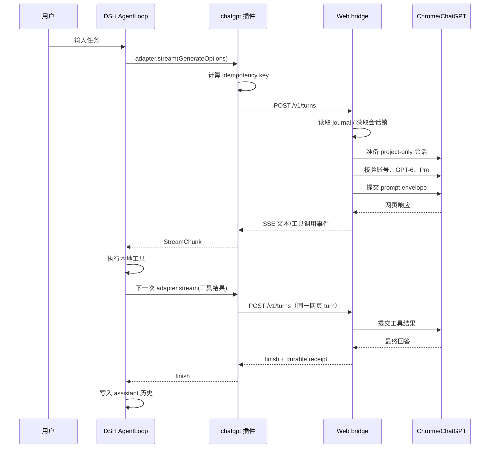

# ChatGPT Web Pro：本地 sidecar provider 方案

[English](chatgpt-web-sidecar.md) | 中文

状态：**方案提案**。本文替代 [chatgpt #9](https://github.com/ckanner/dsh-plugin-chatgpt/pull/9)
和 [flywheel #57](https://github.com/ckanner/flywheel/pull/57) 中需要修改 DSH
源码的方案；不修改 DSH。

## 1. 决定

Web Pro 拆成两个普通组件：

1. 现有的 `chatgpt` DSH provider 插件，通过公开的
   `ctx.llm.registerAdapter()` 注册 `gpt-6-pro-web`；
2. 独立运行的本地 **ChatGPT Web bridge**，负责 Chrome、浏览器 profile、网页会话、
   turn journal、幂等性和恢复。

DSH 保持原版。bridge 是 provider 侧的运行时，不是 harness fork。

模型仍然只支持 **GPT-6 Pro**。GPT-6.2 Astra/Sol 和 UltraFast 属于 SIWC provider，
不是 Web Pro 模型。

## 2. 为什么放弃 host patch

被否决的候选需要 stock DSH 没有的宿主能力：durable response ACK、replay veto、
summary route 元数据、recovered response/summary adoption。它通过修改 DSH 源码
并锁定精确 commit 来补这些能力。

对于可分发的插件，这不可接受：

- 它实质上是 DSH fork，不是插件；
- 每次 DSH 升级都要重新 rebase 补丁；
- 补丁绑定精确源码树，不是版本范围；
- 用户必须替换桌面/SDK 宿主；
- stock 安装无法验证恢复语义。

新方案把这些 provider 侧的持久化职责放进 bridge。DSH 不需要知道模型来自网页。

## 3. 架构

```text
DSH 原版 Host
  Session / AgentLoop / tools / permissions / compaction
        |
        |  公开 llm adapter 接口
        v
dsh-plugin-chatgpt
  provider 注册、模型元数据、附件、配置
        |
        |  loopback HTTP + 每次启动的 token
        v
chatgpt-web-bridge
  turn 队列 / 幂等性 / journal / 恢复
  Chrome 所有权 / CDP / 页面协议 / 图片上传
        |
        |  专用 Chrome profile
        v
ChatGPT 网页（GPT-6 Pro）
```

### 职责边界

| 拥有者 | 职责 |
| --- | --- |
| DSH | 权威会话历史、AgentLoop、工具执行、权限、压缩、重试策略 |
| `chatgpt` 插件 | provider 行、模型选择、配置、附件解析、`StreamChunk` 映射、bridge 健康检查 |
| bridge | Chrome、登录 profile、浏览器事务、prompt、页面协议、工具调用翻译、turn journal、幂等性、恢复 |
| Chrome profile | 仅保存 ChatGPT 网页登录态；不保存 DSH secret 或模型 token |

bridge 不执行 DSH 工具。它只发出已验证的工具调用，由 DSH 决定是否执行。

## 4. 完整交互链路



网页模型不能直接执行 DSH 工具。模型返回严格 JSON 工具调用，bridge 用本次请求的
工具 schema 校验，DSH 执行工具，下一次 adapter 调用把结果带回同一网页 turn。

## 5. 请求身份与幂等性

DSH 可能在网络失败、取消或重启后重试同一个逻辑请求。bridge 必须保证网页不会
被提交两次。

adapter 用公开数据生成稳定的 key：

```text
lastUserSeq = ctx.sessions.get(sessionId) 中最后一条 user/message 事件的 seq
idempotencyKey = sha256(
  sessionId
  + lastUserSeq
  + purpose
  + model
  + reasoningEffort
  + canonical(messages)
  + canonical(tools)
)
```

性质：

- DSH 重试同一请求：key 相同；
- 同一会话中的新用户消息：last-user seq 改变，key 不同；
- 工具结果续轮：messages 变了，key 不同；
- DSH 重启：持久 user event seq 和 messages 一致，key 仍可匹配；
- 切换模型或 effort：key 不同。

key 由插件根据公开 session 状态和请求计算，不需要宿主 hook。

工具续轮时，bridge 将首次 key 对应的网页 turn 身份保存下来；续轮 key 虽然不同，
但同一 session 和已有网页会话引用会让 bridge 把结果接回同一个 turn，而不是新建
项目。

## 6. Bridge API

bridge 只绑定 `127.0.0.1` 的临时端口。插件通过私有 handshake 文件或 stdout
获得端口和本次启动的 bearer token；不得监听 LAN。

### 启动一个 turn

```http
POST /v1/turns
Authorization: Bearer <launch-token>
Content-Type: application/json
Accept: text/event-stream

{
  "idempotencyKey": "sha256:...",
  "sessionId": "session-...",
  "model": "gpt-6-pro-web",
  "reasoningEffort": "pro",
  "purpose": "normal" | "compaction" | "session-title",
  "messages": [ ... DSH messages ... ],
  "tools": [ ... DSH tool schemas ... ]
}
```

响应为 `text/event-stream`：

```text
event: turn        { "turnId": "...", "state": "preparing" }
event: text        { "delta": "..." }
event: reasoning   { "delta": "..." }       （仅展示，可选）
event: tool-call   { "callId": "...", "name": "...", "arguments": "..." }
event: finish      { "reason": "stop", "responseDigest": "...", "state": "completed" }
event: error       { "code": "WEB_UNCERTAIN", "retryable": false, "state": "uncertain" }
```

### 控制接口

```text
GET  /v1/turns/:turnId
POST /v1/turns/:turnId/cancel
POST /v1/turns/:turnId/recover
POST /v1/turns/:turnId/discard
GET  /health
```

`recover` 只读取持久证据并返回已完成的缓存响应，不得重新提交 prompt。
`discard` 记录明确的人工决定，并保留避免重复提交所需的证据。

## 7. Turn 状态机

```text
accepted
   -> preparing
   -> submitted
   -> streaming
   -> completed
   -> failed
   -> uncertain
   -> cancelled
```

至少持久化：

```text
turnId, idempotencyKey, sessionId, model, effort, purpose
requestHash, conversationUrl, conversationId, promptMessageId
responseDigest, providerResponseId, toolCalls, state
createdAt, updatedAt, lastObservedAt
```

规则：

- `completed`：缓存完整响应，同 key 重试直接返回；
- `submitted` 但结果未知：`uncertain`，绝不自动重发；
- `cancelled`：保留证据，不静默开始替代 turn；
- bridge 重启：重放 `completed`，核对 `streaming`，隔离 `uncertain`；
- 同一个 Chrome profile 全局串行；每个 DSH session 只获得队列位置，不能并发
  修改页面；
- journal 原子写入并 flush 后才发出 `completed`。

## 8. 工具调用闭环

网页 ChatGPT 没有公开的工具调用 API，因此 bridge 使用严格、带版本的 prompt envelope：

1. 携带 DSH 本次请求的精确工具 schema；
2. 要求模型返回单个 JSON 工具调用对象；
3. 校验工具名、参数和 call ID 是否属于本次请求；
4. 发出 DSH `tool-call` chunk；
5. DSH 在自身权限策略下执行工具；
6. 将持久工具结果发回同一网页 turn；
7. 重复直到最终文本。

bridge 不创造工具、不扩大权限。未知工具、错误参数、重复 call ID、乱序结果
全部 fail closed。

## 9. 压缩与会话标题

DSH 拥有历史和 CompactionEngine。对于 `purpose: "compaction"`，bridge：

- 使用独立的摘要会话，不污染主任务会话；
- 禁用工具；
- 只返回文本；
- 使用相同的幂等和 journal 规则；
- 不修改 DSH 历史。

`session-title` 可选，使用短文本、无工具的 turn，与主模型路由分离。

## 10. 模型选择与元数据

插件注册现有 `chatgpt` provider，并增加一个显式 Web 模型：

```text
provider: chatgpt
model: gpt-6-pro-web
label: GPT-6 Pro · Web
reasoningEffort: pro
```

只有 bridge 健康且 Web 功能启用时才列出该模型。`resolveModel` 校验精确
model/effort。如果账号、浏览器登录、GPT-6 控件或 Pro 控件不可用，在提交任何
prompt 之前失败。

现有 SIWC 模型名册独立且仍由账号目录动态决定。GPT-6.2 Astra/Sol 和 UltraFast
是 SIWC 能力，不是 Web 模型。

## 11. 安全与隐私

- bridge 只监听 loopback；每次启动生成本地 bearer token，不写日志；
- 专用 Chrome profile 位于用户主目录下，目录权限 0700；
- Chrome remote debugging 端不暴露到 loopback 之外；
- bridge 只接收显式请求所需的会话内容；
- DSH 工具权限是本地执行的唯一授权；
- 网页文本和模型输出均不可信；prompt injection 不能获得工具或权限；
- profile 锁防止两个 bridge 同时驱动同一 profile；
- 中断 HTTP stream 不等于浏览器停止：提交后取消应保持 uncertain，直到页面证据
  被核对。

## 12. 进程生命周期与安装

插件包管理 bridge 子进程：

- 插件启动时请求 `GET /health`；不存在则启动随包分发的 bridge 可执行文件，
  使用临时端口；
- bridge 通过私有 handshake 文件提供端口和启动 token；
- 插件 dispose 只停止自己启动的 bridge；外部配置的 bridge 保持运行；
- `bridgeCommand` / `bridgeUrl` 配置允许独立管理 bridge；
- Chrome 由 bridge 使用专用 `--user-data-dir` 启动；bridge 拥有进程组并清理；
- 首次使用打开可见登录窗口；不把 DSH 凭据复制进浏览器 profile。

不修改任何 DSH 源码、包或应用程序。

## 13. 失败矩阵

| 失败 | 结果 |
| --- | --- |
| 提交前 bridge 不可用 | 可重试 provider 错误；无浏览器动作 |
| Chrome 启动失败 | 可重试初始化错误；无 prompt |
| 账号/模型/effort 不匹配 | 提交前不可重试 admission 错误 |
| 提交响应丢失 | `uncertain`；不自动重发 |
| 提交后浏览器断连 | `uncertain`；重启后核对 |
| DSH 同 key 重试 | 返回缓存完成响应，或保持同一 pending 状态 |
| 提交前 DSH 取消 | `cancelled`；不提交网页 |
| 提交后 DSH 取消 | 保持 `uncertain`，直到页面证据核对 |
| 工具调用格式错误 | turn 失败；不执行工具 |
| 工具结果不确定 | 执行域保持隔离；不重发 |
| 压缩请求失败 | DSH 保留原历史并报告失败 |

## 14. 测试与验收

### 单元

- idempotency key 在重试、新用户消息、重启下的稳定性；
- 状态机和 journal replay；
- API 校验、鉴权、取消、非法输入；
- 工具 envelope 校验和未知工具拒绝；
- 响应缓存与 `uncertain` 隔离。

### 不依赖桌面 DSH 的集成

- adapter 对 mock bridge 的 SSE 契约；
- bridge 对 fixture Chrome 页面；
- 真实 DSH AgentLoop + stock host + fixture 页面完成一次工具闭环；
- compaction 与 session-title purpose；
- 重试/取消/重启旅程。

### 真实验收

1. stock DSH `0.2.2-rc.5`；
2. 只安装插件和 bridge；
3. 专用 Chrome profile 登录；
4. 选择 `GPT-6 Pro · Web`；
5. 文本回答；
6. 本地工具调用与结果；
7. 图片输入；
8. 取消/重试，不重复提交网页；
9. bridge 重启和 DSH 重启恢复；
10. DSH 0.2/0.3 升级无需改源码。

验收不包含 host patch。

## 15. 从被否决候选迁移

1. 冻结 #9/#57，不合并、不发布。
2. 将 #9 的 browser/CDP/page/recovery 代码抽成独立 bridge 包；移除所有
   host-hook 依赖。
3. 保留现有 provider/adapter 代码作为薄 bridge client。
4. 增加幂等层和 journal 层。
5. 先实现 mock bridge 和契约测试，再迁移浏览器细节。
6. 逐步迁移工具、图片、压缩和恢复。
7. bridge 和插件独立发布；Flywheel 只消费同一个 provider route，不需要特殊集成。

可复用：CDP 所有权、页面模型校验、图片上传、响应解析、工具协议、取消和证据模型。
必须丢弃：host policy hooks、host patch、宿主源码树锁定，以及“插件可以保证宿主级
durable ACK”的声明。

## 16. 现有 PR 的处理

| PR | 处理 |
| --- | --- |
| [dsh-plugin-chatgpt #9](https://github.com/ckanner/dsh-plugin-chatgpt/pull/9) | **关闭，标记为被本方案取代（superseded）。** 保留分支和提交作为研究证据；不合并、不发布。 |
| [flywheel #57](https://github.com/ckanner/flywheel/pull/57) | **关闭，标记为被本方案取代。** 它依赖 #9 的 patched host；不合并、不发布。 |
| [dsh-plugin-chatgpt #10](https://github.com/ckanner/dsh-plugin-chatgpt/pull/10) | 已合并；DSH 0.2–0.3 peer range 属于正常插件。 |
| [dsh-plugin-chatgpt #11](https://github.com/ckanner/dsh-plugin-chatgpt/pull/11) | 已合并；GPT-6.2 元数据属于 SIWC provider。 |
| [dsh-plugin-chatgpt #12](https://github.com/ckanner/dsh-plugin-chatgpt/pull/12) | 已合并；UltraFast 服务档变体属于 SIWC provider。 |
| [dsh-plugin-chatgpt #13](https://github.com/ckanner/dsh-plugin-chatgpt/pull/13) | 已合并；显示名称。 |
| [flywheel #59](https://github.com/ckanner/flywheel/pull/59) | 已合并并发布为 Flywheel 0.37.3。 |

关闭 #9/#57 时保留分支和验证记录。host patch 不从 Git 历史删除，只是不再属于
受支持的产品路径。

## 17. 交付阶段

1. **方案** — 本文、评审和 PR 处理。
2. **bridge 骨架** — API、journal、幂等、mock page、插件 adapter client；暂不接
   真实浏览器。
3. **纯文本 Web Pro** — 真实 Chrome、登录、账号/模型/Pro 校验、文本 turn。
4. **工具闭环** — schema envelope、校验、DSH 工具执行、工具结果续轮。
5. **图片与压缩** — 上传、summary purpose、unknown usage。
6. **恢复加固** — 取消、重启、uncertain、管理命令。
7. **真实验收与发布** — stock DSH、登录账号、macOS Desktop、CI fixture、
   文档化限制。

每个阶段独立 PR；任何阶段都不修改 DSH 源码。

## 18. 待定问题

- bridge 实现语言：先用 TypeScript，复用现有 CDP/page 代码；只有进程启动成为
  分发瓶颈时才做 native binary。
- 初期把 bridge 打进插件包，同时支持外部 `bridgeUrl`；后续再考虑拆包。
- 原 turn 已关闭后，completed 缓存是否允许之后 DSH 重试返回。初始策略：
  只允许同 key 重试；否则留给显式检查。
- Web usage 是否保持 unknown（不伪造计数）。初始答案：是；bridge 无法单独保证
  hard budget。
- 恢复入口用 provider 命令还是设置卡片。初始答案：两者都要，命令作为恢复入口。

## 19. 方案验收标准

- stock DSH 可选择 `GPT-6 Pro · Web`，无需 host patch；
- 每个逻辑请求最多提交一次网页；
- DSH 重试和重启返回缓存或 uncertain，不重复提交；
- DSH 工具只通过 DSH 权限执行；
- 插件和 bridge 可独立于 DSH 升级；
- #9/#57 已关闭，且没有任何发布依赖 patched DSH。
