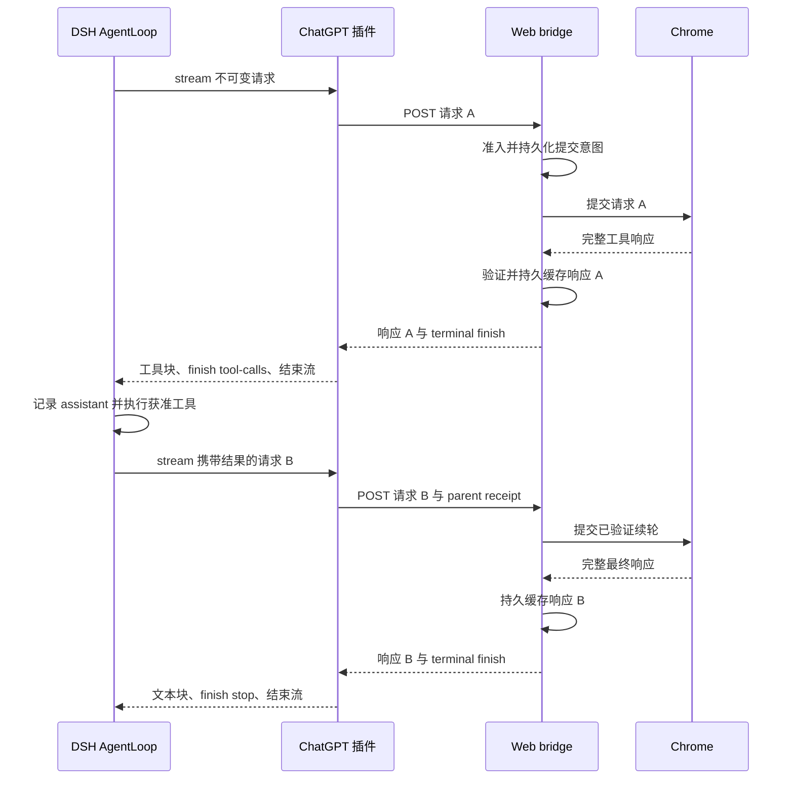
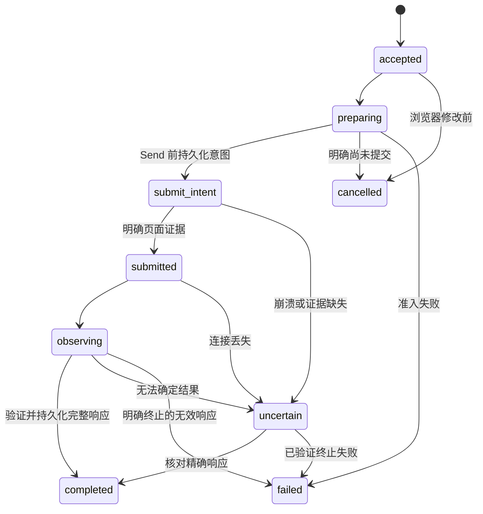

# ChatGPT Web Pro：本地 sidecar provider 方案

[English](chatgpt-web-sidecar.md) | 中文

状态：**已复审的架构，后续实现正在交付**。PR #14 承载设计，PR #15 承载持久化基础，
后续浏览器与 provider 候选实现设置、图片和恢复。参见[设置与验收指南](../web-provider.zh.md)；
fixture 覆盖不等于真实登录网页验收。它取代 [chatgpt #9](https://github.com/ckanner/dsh-plugin-chatgpt/pull/9)
和 [flywheel #57](https://github.com/ckanner/flywheel/pull/57)；两者均已关闭、未合并。
本方案不修改 DSH 源码。

## 1. 决策

通过现有 `chatgpt` provider 和本地 `chatgpt-web-bridge` 进程提供 Web Pro。
插件使用公开 `ctx.llm.registerAdapter()` 接口；bridge 拥有 Chrome、专用 profile、
网页协议、请求 journal 和 provider 侧恢复。

DSH 继续拥有 AgentLoop、权威历史、工具、权限和压缩。bridge 可以保证自身提交的
持久性与幂等性，但不能承诺宿主 ACK、本地工具恰好执行一次，或阻断其他 provider。

Web 模型仍仅为 **GPT-6 Pro**：
`chatgpt / gpt-6-pro-web / pro`。GPT-6.2 Astra/Sol 和 UltraFast 仍属于 SIWC。
现有 SIWC 的认证、目录和请求行为保持独立；Web 登录态和 receipt 使用自己的命名空间。

### 复审依据

本方案对照未修改的
[DSH 源码](https://github.com/deepseek-ai/deepseek-harness/tree/2e39e70496aa02986ca6a820c5d497e816b69d7e)、
[ChatGPT 插件基线](https://github.com/ckanner/dsh-plugin-chatgpt/tree/afec4caef1dd4a55926e5de29ccb992be63fd7d9)
及 [Flywheel main](https://github.com/ckanner/flywheel/tree/f016015a884351d081e066a4031a6814299f25e5)
核对公开契约。这些固定源码链接是复审证据，不是运行时宿主 tree 绑定。
已发行 DSH `0.2.2-rc.5` tag 为 `9c2670d3bce5275e0d1610272958121af87787bb`，
它是不同的源码树，实施验收必须覆盖该发行版本。声明 0.2/0.3 peer range
不代表其中每个版本都已经实测。

## 2. 为什么否决宿主补丁

旧候选通过修改 DSH 源码增加 durable response ACK、replay veto、summary-route
元数据和 recovered-response adoption。用户因此必须替换 Desktop/SDK 宿主，并在
升级时维护精确源码补丁，不符合可分发插件的目标。

原版 DSH 已有自己的
[session checkpoint policy](https://github.com/deepseek-ai/deepseek-harness/blob/2e39e70496aa02986ca6a820c5d497e816b69d7e/packages/session/session-checkpoint-policy/src/index.ts)：
正常宿主组合安装该策略后，会在模型请求和顶层工具派发前 flush 对应日志。
这是 DSH 自己的持久化边界；bridge receipt 不能充当该边界的确认。

新方案把 provider 持久化放在 bridge，通过公开插件接口连接，不用隐藏 shim
重新实现旧宿主 hook。

## 3. 架构与职责

原版 DSH adapter 通过经过认证的 loopback HTTP 调用 bridge，bridge 使用自己
的 Chrome profile 驱动网页。

| 拥有者 | 职责 |
| --- | --- |
| DSH | Session 历史、AgentLoop、工具、权限、压缩、重试策略、宿主 checkpoint |
| `chatgpt` 插件 | Provider/模型元数据、附件解析、精确请求规范化、bridge client、`StreamChunk` 映射、设置界面 |
| bridge | Profile/账号绑定、浏览器动作串行化、页面协议、journal、响应缓存、Web 请求隔离 |
| Flywheel | 自己的 SDK 调用、任务/角色/candidate 证据、预算、编排及消费侧恢复策略 |
| Chrome profile | 网页登录态和 bridge 管理的聊天；不复制 DSH 凭据 |

bridge 不执行 DSH 工具。模型响应完成、工具调用已投递、工具结果已产生、
Flywheel 任务已完成，是不同的事实。

## 4. 完整交互链路

一个 **provider request** 对应一次有限模型响应；一个 **网页 conversation**
可以包含多次请求。工具续轮是在同一个已核验 conversation 中进行的**新 provider
request 和新网页提交**。



[原版 AgentLoop](https://github.com/deepseek-ai/deepseek-harness/blob/2e39e70496aa02986ca6a820c5d497e816b69d7e/packages/core/agent-loop/src/agent.ts)
先完整消费 stream，再记录 assistant，最后执行工具。因此，**每次工具响应都必须
先 finish 并关闭流，才能等待工具结果**。bridge 在该边界释放浏览器动作槽位，
不能在 DSH 执行本地工具时继续占用旧 stream 或 profile 队列槽位。

## 5. 请求身份与幂等性

### 5.1 身份来自本次接纳的请求快照

公开的
[`GenerateOptions` 与 `RequestMessage`](https://github.com/deepseek-ai/deepseek-harness/blob/2e39e70496aa02986ca6a820c5d497e816b69d7e/packages/llm/llm/src/types.ts)
允许独立 `system`、可选 `sessionId`/`purpose`、带稳定 ID 的持久消息，以及没有
身份的一次性输入。插件必须区分这些情况，不能读取 live session 最新的
`user/message` seq 来猜请求身份：异步请求可能使用更早快照，重试也可能重新生成
runtime context 或压缩历史。

插件在异步附件解析或 bridge 操作之前，先脱离 caller 捕获不可变 GenerateOptions
快照；随后以该快照解析精确附件版本、获取已认证 bridge 的持久
installation/profile/account 绑定，在准入前完成 wire envelope/hash，不能重新读取
可变 caller 输入。实际修改页面前再次复核绑定。

```text
binding = {
  protocolVersion, installationId, providerRoute,
  profileId, accountBinding, sessionId, purpose
}
anchor = identities from this request's admitted input
payload = normalize(model, reasoningEffort, system, ordered messages, tools,
                    controls, attachment versions, parentReceipt)
requestHash = sha256(canonical({ binding, anchor, payload }))
idempotencyKey = requestHash
```

规范化使用排序后的对象 key、有序数组和无歧义的带类型序列化。保留有效的
system/developer 指令、工具 schema 与结果、模型/effort、有效生成参数及图片 bytes
摘要；语义请求 hash 不包含 signal、临时端口、启动 token、client lease、delivery
attempt 和传输时间戳。bridge 独立重新计算 hash；同 key 却不同 envelope 必须报冲突。
准入或命中缓存前，parent receipt 还必须与已参与 hash 的 assistant 历史中派生的
receipt 一致。

| 请求 | 身份与准入 |
| --- | --- |
| 普通 AgentLoop | 必须有 session ID，以及传入请求自身的稳定消息 IDs；surface replacement 可能改正文，所以仍须包含完整有效请求 |
| Compaction | 已有源消息 IDs、purpose、完整摘要输入；末尾总结指令可以合法地没有 ID |
| Session title | Session/purpose 加语义标题输入、system、生成参数；仅对该 purpose 忽略 producer 新生成的包装消息 UUID |
| 无身份的普通 one-shot | v1 在浏览器动作前拒绝；不能使用空 session、每次随机 key，或其他请求的 live user event |

标题使用相同语义输入时，明确视为同一份可缓存工作。之后又运行一次 title producer，
不代表原请求已被宿主消费。各 purpose 只接纳明确支持的 caller 形态；扩展 one-shot
须提供持久 operation identity 并单独验证。

### 5.2 保证与限制

bridge 保证**同一个已接纳的精确请求身份至多提交一次**。DSH 改写请求、压缩、
fork 或创建新 session 后，bridge 无法识别所有语义上的重试，不能把不同输入
自动称为同一个逻辑操作。

所有 key，包括新 key，都先经过持久 profile 和 conversation 准入检查。
未解决的提交意图或浏览器结果会阻断该 profile 后续提交，包括另一 DSH session。
切换模型、effort、账号或 profile 不会自动解决旧记录，必须显式检查和对账。

同一个 pending key 关联已有工作；已完成纯文本可以从缓存返回。含工具响应遵循
§8 更严格的投递规则。这里的隔离只约束通过该 bridge 的 Web 请求，不覆盖 SIWC、
其他 bridge 安装、其他 provider 或任意本地工具。

## 6. Bridge API

v1 只绑定 `127.0.0.1` 临时端口。所有端点都要求私有的每次启动 bearer token。
已认证 health/admission 响应标明实例、协议版本和当前 profile/账号绑定；
没有核验过的绑定时应进入 setup，不得直接提交模型请求。

### 一次有限请求

```http
POST /v1/turns
Authorization: Bearer <launch-token>
Content-Type: application/json
Accept: text/event-stream
```

以下是结构示例，JSON 本身有效：

```json
{
  "protocolVersion": 1,
  "clientLeaseId": "client-lease",
  "deliveryAttemptId": "delivery-attempt",
  "idempotencyKey": "sha256:request-digest",
  "installationId": "bridge-installation",
  "provider": "chatgpt",
  "profileId": "dedicated-profile",
  "accountBinding": "verified-account-fingerprint",
  "sessionId": "session-id",
  "purpose": "normal",
  "model": "gpt-6-pro-web",
  "reasoningEffort": "pro",
  "system": "Effective out-of-band instructions, when supplied",
  "messages": [
    {
      "id": "durable-message-id",
      "role": "user",
      "content": [{ "type": "text", "text": "Inspect the requested file." }]
    }
  ],
  "tools": [],
  "controls": {},
  "attachmentVersions": [],
  "parentReceipt": null
}
```

只有原请求未提供 purpose 时才规范化为 `normal`；协议识别的辅助 purpose 为
`compaction` 和 `session-title`。识别 purpose 不代表支持它要求的生成参数；
不支持的 purpose 或参数在浏览器动作前失败。Client lease 与 delivery-attempt ID
控制响应投递所有权，不会产生新的模型请求身份。

插件按照现有[请求转换器](../../src/convert/request.ts)的优先级转发
`GenerateOptions.system`，有效指令同时进入 hash 和实际发送正文，不能因为它们
不在首条消息中就丢弃。支持的生成参数规范化进 `controls` 并参与 hash；
网页无法忠实实现的参数必须拒绝，不能静默丢弃或声称是 provider 强制上限。
摘要输出上限见 §9。

图片通过公开 attachment service 解析为本次 request-version 的精确 bytes。
API 携带已校验 MIME、长度和摘要，使用 inline bytes 或 bridge 自己管理且核验摘要的
blob reference。不接受任意本地路径，也不能用附件名称替代图片。
不支持的 file block 在上传前拒绝。

### 响应事件与宿主映射

SSE 使用标准 `event:`、`data:` 行，事件之间以空行分隔：

```text
event: turn
data: {"turnId":"request-a","state":"accepted"}

event: finish
data: {"turnId":"request-a","reason":"tool-calls","responseDigest":"sha256:response","state":"completed"}

```

这个片段省略了 response payload。带版本的响应 schema 必须包含完整已验证文本/
工具块、稳定 call IDs 和 receipt；单独的 `finish` 不构成响应。v1 缓存并验证完整
网页 envelope 后，才暴露可执行的工具块。真实观测到的 progress 事件与模型内容
分开，不能伪造 reasoning 或 usage。

插件将已验证响应映射为公开的 `block-start`、deltas、`block-end` 和 terminal
`finish`。工具响应以 `reason: { kind: 'tool-calls' }` 结束；最终文本以
`reason: { kind: 'stop' }` 结束，随后关闭 generator。finish 后不能继续成功输出；
未观测到 usage 时省略它。

bridge 的 `WEB_UNCERTAIN` 映射成公开的结构化 LLM failure，并显示恢复指引。
bridge JSON 的 `retryable: false` 不是宿主 replay veto：stock 重试策略按 code
决策。即使宿主重试该错误，或 consumer 把它转成通用 code，bridge 仍须在后续
每次准入时执行自己的隔离检查。

### 控制接口

```text
GET  /v1/turns/:turnId
POST /v1/turns/:turnId/cancel
POST /v1/turns/:turnId/recover
POST /v1/turns/:turnId/discard
POST /v1/clients
POST /v1/clients/:clientId/heartbeat
DELETE /v1/clients/:clientId
GET  /health
```

`recover` 进行已认证、只读的 journal/页面对账，返回证据或完成响应缓存；不能
重新提交、执行工具或写入 DSH 历史。`discard` 记录明确决定并保留 tombstone，
既不是重跑工具授权，也不能证明远端生成已停止；浏览器仍 active/unknown 时继续
隔离该 profile。控制请求校验 caller 的 installation、session 和 turn 所有权。
Client registration 分配私有 lease；heartbeat 只维持该 client 的所有权，不能
作为模型 activity。Release 只影响该 lease；实现契约须限制有效期并拒绝过期 lease。

## 7. 请求状态机与持久化



journal 至少记录：

```text
schemaVersion, bridgeInstanceId, installationId, profileId, accountBinding
turnId, idempotencyKey, requestHash, sessionId, purpose, model, effort
generationId, projectId, conversationId, conversationUrl, parentReceipt
normalizedRequest, attachmentDigests, submissionIntent, observedPromptId
completeResponse, responseDigest, stableToolCalls, deliveryOwner, deliveryState, state
createdAt, updatedAt, lastObservedAt, fenceReason
```

规则：

- 获取 profile/record 锁，核验绑定并持久化准入记录。
- **任何 Send 动作之前先原子写入并 fsync `submit_intent`。** 点击后、
  `submitted` 写入前崩溃，重启仍能看到 intent，只能对账，不能退回可发送的
  `preparing`。
- 项目创建、上传和清理也记录各自 mutation intent 与观察到的身份；结果不明确
  的 setup 动作不能盲目重复。
- 发出成功模型内容或 finish 之前，先持久化并 flush 完整已验证响应、tool IDs
  和摘要。额度/超时/错误页面，以及稳定的部分文本，都不能视为已完成回答。
- journal 耐久性包括原子替换、必要的文件和父目录同步。已有安装发生损坏、
  证据丢失或 journal 不见时准入失败，不能初始化为空 registry 后继续工作。
  首次安装通过显式 setup 建立身份与存储。
- 提交后的取消保持 `uncertain`，直到页面证据确定结果。关闭 HTTP 或结束
  Chrome 都不能证明网站停止生成。
- 并发同 key 共享一个浏览器操作，但不代表每个订阅者都获得可执行响应投递权（§8）。
  不同 key 也不能绕过未解决的 profile 隔离；每个物理 profile 的浏览器修改串行执行。
- 模型响应完成与宿主投递是两种状态；工具响应在第一个可执行 chunk 暴露前
  持久化 exposure 意图，见 §8。
- `failed`、`cancelled`、`discarded` 保留身份/tombstone；新操作需要明确且
  可接纳的输入，不能重置旧 key。

## 8. 工具闭环、receipt 与恢复边界

页面收到严格的带版本 envelope，只包含本次接纳的工具 schema。bridge 完整校验
响应、精确名称、JSON 参数和 call IDs 后才映射为 DSH blocks。它不扩大权限、
不执行工具，也不把普通文本当工具结果。

每个模型响应，包括工具响应，都是独立完成的 provider request。稳定 call IDs
归属于该响应，响应内部重复 ID 必须拒绝；之后历史里的另一个响应可能合法复用
网页短 ID，因此续轮按 parent receipt 和 call occurrence 校验，不能全局比较短 ID。

公开的
[`finish.replayState`](https://github.com/deepseek-ai/deepseek-harness/blob/2e39e70496aa02986ca6a820c5d497e816b69d7e/packages/llm/llm/src/types.ts)
可在 `ReplayEnvelope.response` 携带 adapter 私有 receipt：

```json
{
  "kind": "chatgpt-web-receipt",
  "version": 1,
  "installationId": "bridge-installation",
  "provider": "chatgpt",
  "profileId": "dedicated-profile",
  "accountBinding": "verified-account-fingerprint",
  "sessionId": "session-id",
  "purpose": "normal",
  "model": "gpt-6-pro-web",
  "generationId": "generation-id",
  "turnId": "request-a",
  "requestHash": "sha256:request",
  "responseDigest": "sha256:response"
}
```

DSH 可将其保存在 assistant source，并在之后请求中带回。bridge 必须结合自己的
journal、当前 session/generation、精确 assistant blocks 和有序工具结果校验。
复制/fork 的 receipt、其他账号或已改变的 prefix 不能采纳旧请求。

SIWC 与 Web 属于同一个 adapter，宿主过滤不会自动隔离两者的 opaque state。
每个分支只识别自己的 kind/version/route/model/account scope；SIWC 的 opaque state
不能变成 Web 指令或 receipt。

### 工具投递边界

DSH 拥有权限决策、工具执行和结果持久化。普通 adapter request 不携带通用的、
带类型的工具执行/未知结果证明，`isError` 和错误文本不能充当这种证明。

v1 在暴露工具响应之前持久化 `delivery-intent`。原子、持久的 claim 只把首次
投递权授予一个 `clientLeaseId + deliveryAttemptId`；其他同 key 订阅者只能
查看状态/检查，不能收到第二份可执行响应。Owner 丢失时不自动转移 claim，而是
进入检查；已完成的纯文本响应可以共享。一旦可能已经暴露，**之后的
provider retry 不自动再次发出该工具响应缓存**：只能识别包含 parent receipt 和
完整匹配结果集合的有效续轮，否则要求显式检查。结果缺失、不完整或冲突，都不能
授权另一轮工具执行。不中断的首次投递是正常支持路径；更宽松的重连须另行证明和测试。

receipt 只证明 bridge 记录了什么，不证明 host fsync、工具成功、安全重放或
Flywheel 任务完成。bridge 不安装全局 DSH 工具隔离。正常 stock checkpoint 行为
仍属于 DSH；自定义宿主组合必须验证自身策略。

## 9. 历史投影、压缩与标题

### 9.1 网页必须对应当前 DSH 请求

DSH request surface 是权威输入。bridge 持久记录
`installation/account/profile/session/purpose/generation` 绑定、精确投影 prefix
和 receipt 链。

只有对该 prefix 精确且可验证的追加，才能在已有 conversation 中发送 delta。
压缩、fork、历史替换、有效指令/工具变化或无法验证的页面编辑，都需要新代次，
从**当前**请求重新建立上下文。bridge 不能把改写后的全量历史再追加到旧 chat，
不能静默截断，也不维护第二套摘要。

新代次必须新建空的、私有的 **project-only Project 和 chat**，不只是同 Project
里的另一条 chat。OpenAI 明确说明
[project-only memory 仍可引用同 Project 的其他 conversation](https://help.openai.com/en/articles/10169521-projects-in-chatgpt)，
所以复用旧 Project 可能让 DSH 已删除的历史重新进入模型上下文。
旧代次保留为可检查证据，不复制进新 Project，也不自动删除。

输入或上传前校验真实账号、Project、conversation、GPT-6/Pro 控件，以及没有
冲突的活动生成/hosted app mode；上传后和实际发送前再次核验。URL 相同不足以证明
身份未变。如果上下文隔离或输入容量无法确定，在提交前失败，不能把网页自己截历史
当成 DSH compaction。

### 9.2 辅助请求

`purpose: compaction` 使用独立 purpose 的 Project，禁止工具执行，只返回已验证
文本。宿主可能为了 prefix 对齐而附带历史工具 schema；它们作为输入参与 hash，
但不能成为摘要响应中的活动工具。失败或截断摘要不能替换 DSH 历史。

原版 summarizer 可使用自己配置的 provider/model，路由决定仍留在 DSH。
网页输入/输出限制必须明确：请求中的 `maxTokens`、`temperature`、`stop`
不会自动成为网页能力。不支持的强制参数应给出明确 option 错误。
原版摘要 producer 每次都传 `maxTokens`，标题 producer 同样传输出上限。
在 Web 参数强制能力尚未证明时，启用长 Web 会话前，setup 必须检查现有 DSH
设置中已显式配置支持这些参数的摘要 provider/model；模型生成标题也需要显式的
受支持路由，否则可选 title 功能保持禁用。不能静默切换路由，也不能把默认回落
到 Web 模型算作受支持配置。只有参数语义和 overflow 行为得到验证后，才接纳
Web 辅助请求。Unknown usage 不能变成零计数或严格 token 预算保证。

`session-title` 是可选的短文本调用，独立隔离并按 §5 的语义输入寻址。
不能选择更新的 live user event、执行工具、污染任务 Project，或声称新生成的
标题 UUID 一定是旧请求的重试。

## 10. 模型选择与元数据

保留现有 provider；Web 功能启用且 bridge 就绪时增加显式模型：

```text
provider: chatgpt
model: gpt-6-pro-web
label: GPT-6 Pro · Web
reasoning.efforts: [pro]
reasoning.defaultEffort: pro
```

公开的 `resolveModel(provider, model, signal?)` 没有 effort 参数。
它负责解析精确模型并返回 reasoning 元数据，stock call resolution 校验请求 effort；
插件和 bridge 在派发、实际 Send 前继续验证真实 model/effort。不支持的选择应失败，
不能静默改成另一档。

目录健康状态控制可见性，不是唯一准入门禁。已经保存的模型在 bridge 或登录不可用时，
仍须给出明确错误。SIWC 名册继续来自自己的账号目录，认证和失败行为保持独立。

## 11. 安全与隐私

- 所有 bridge 端点（含 status/recovery）都鉴权，token 不写日志。
- 强制字面 loopback 地址、校验 Host/Origin、禁用宽泛 CORS 和 redirect，
  限制请求/事件/图片大小；`bridgeUrl` 不能把本地协议变成未经评审的远端服务。
- Profile、journal、handshake 目录仅 owner 可访问（0700），文件权限 0600；
  请求和响应按敏感本地数据保护。
- Profile 锁绑定 canonical 物理路径和 OS 用户；核对 handshake 的实例身份，
  单独的旧 PID/端口不足以证明所有权。
- CDP 使用 loopback 或私有 pipe；只复用 bridge 拥有的 Chrome，不附着或结束
  任意用户浏览器。
- 只通过宿主公开服务解析本次显式附件；bridge API 不提供任意文件读取或
  不受限 URL 抓取。
- 网页/模型文本不可信，不能增加工具、提升权限、切换账号或授权恢复操作。
- 登录由用户在专用 profile 可见完成；不复制 DSH/SIWC 凭据，也不在 setup 中
  静默改变账号的 memory/privacy 设置。

## 12. 进程生命周期与安装

v1 将 TypeScript bridge runtime 打包进插件。使用普通插件安装流程和显式登录/setup，
不替换应用或 DSH 包。独立管理的 bridge 是可选项，仍须本地、鉴权并校验协议版本。

每个物理 profile 只有一个 bridge 服务，其生命周期独立于第一个插件客户端：

1. 在 profile 所有权锁下原子发现/启动；加入前核验私有 handshake、instance ID、
   协议和绑定。
2. 每个 Desktop/SDK client 有自己的 lease 和请求所有权；后来加入者不从属于
   最初 launcher 的生命周期。
3. 插件 dispose 只释放自身 lease、取消自己的请求，不能杀死共享 bridge 或
   另一个 client 的生成。
4. 没有活动 client lease 和工作后，bridge 才可按明确 idle policy 退出；
   uncertain 工作应先持久化/对账。
5. 只清理 bridge 实际创建且仍可识别的 Chrome 进程组。外部 bridge 的生命周期
   始终由外部 owner 管理。

显式可信的 `bridgeCommand` 使用可执行文件与参数数组，不拼接 shell 字符串。
启动时核验托管包和协议版本。丢失 journal 或替换 profile 是显式恢复操作；
自动重启不能创建空证据目录后把旧工作当成新请求。

## 13. 失败矩阵

| 失败 | 结果 |
| --- | --- |
| 准入前 bridge 不存在 | Setup/transport 失败；无浏览器动作 |
| 账号/模型/effort/参数不匹配 | 上传/输入前准入失败 |
| 意图已持久化，提交确认前崩溃 | Uncertain；只对账，不能盲目再 Send |
| 提交后页面断连 | Profile 保持隔离，直到精确结果确定 |
| 同 key、同 envelope | 关联已有工作，或重放允许返回的文本缓存 |
| 同 key、不同 envelope | 冲突；不修改页面 |
| Profile 结果未知时收到新 key | 同样隔离；新 session/模型不能绕过 |
| 取消时有明确未发送边界证据 | 保留证据的 cancelled；不新建替代请求 |
| Intent/提交之后取消 | 对账前保持 uncertain |
| 非法/部分/错误页响应 | 不返回成功文本/工具响应；保留已提交证据 |
| 工具响应可能已投递，但缺结果 | 要求检查；不自动再次投递工具响应 |
| 摘要/标题失败或参数不支持 | 宿主保留历史；bridge 不自行替换 |
| 最初启动的 Desktop 退出，SDK 仍活动 | 仅释放该 client lease；共享服务保持运行 |

## 14. 测试与验收

以下是**待实现的门禁**，不是本设计 PR 已完成的测试结果。

### 单元与协议

- 精确 envelope 的 hash 包含独立 system、生成参数、account/profile/provider
  身份和图片版本。
- 普通稳定输入、compaction 末尾无身份指令、语义寻址标题，以及拒绝匿名普通调用。
- 同 key 冲突、并发重复请求，以及 profile 被隔离时的新 key/session。
- 两个同 key consumer 只能产生一次网页提交和一次可执行工具响应投递；
  owner 丢失不能转移投递权。
- 每次 journal 写入、fsync、Send、响应缓存、tool-delivery intent 前后注入故障；
  不重复发送、不自动再次暴露可执行工具响应。
- 完整 SSE/StreamChunk 终止、已验证 blocks 和稳定 tool IDs；不把部分响应提升为成功。
- Fork、复制 session、切换账号、SIWC/Web 之间的 receipt 校验。
- 压缩/历史漂移后新代次及 Project 隔离；附件重放使用精确请求 bytes。
- 双 client 启动/dispose 竞争、旧 handshake、owner 崩溃、鉴权和输入边界。

### 原版宿主集成

- 公开 adapter 加 stock AgentLoop，围绕一次本地工具执行完成两次模型请求；
  第一次 stream 在工具开始前结束。
- 保留正常 stock checkpoint policy，不使用 monkey patch 或复制宿主源码。
- Runtime-context refresh/compaction 后的 retry 验证改变的 envelope 与隔离，
  不假设 key 一定不变。
- 摘要/标题保留 `system` 并使用独立 purpose 上下文；不支持的参数失败且不丢历史。
- 响应暴露、DSH 重启、bridge 重启、工具结果歧义分别验证，不能拿网页恢复替代。
- 共享 Desktop/SDK client 不能终止对方工作。

### 真实验收

使用已发行的原版 DSH `0.2.2-rc.5`，只安装插件/bridge，登录、选择 Web Pro，
在 macOS 上验证文本、工具、图片、长历史/代次变化、取消、两种重启与多 client。
对每个声明支持的 0.2/0.3 发行版本复跑相关契约后，才能称其已测试。
Fixture Chrome 和离线契约不能证明真实登录网页行为。

## 15. 迁移与 Flywheel 集成

### 复用被否决候选中的代码

保持 #9/#57 关闭并保留分支/历史。选择性抽取已审查的 CDP、页面核验、图片、响应
解析和取消代码；移除 host-hook 依赖、旧 host-tree 准入和全局恢复保证。
不能把旧 alpha archive 当成新 bridge 合并或发布。

先实现公开协议和崩溃测试，再迁移浏览器。初期分发决定是随插件打包 bridge；
以后拆包必须保持协议与 journal migration 兼容。

### Flywheel 需要独立集成 PR

Flywheel 可复用 `harness: dsh` 和普通 `chatgpt` provider route，但其现有 UI、
policy 和 recovery 不会因此自动理解 Web。
[当前 main](https://github.com/ckanner/flywheel/tree/f016015a884351d081e066a4031a6814299f25e5)
有以下明确后续要求：

| 边界 | 当前行为与后续工作 |
| --- | --- |
| 精确 model/effort | UI 无新增 `pro` 选项；空 DSH thinking 变成 `high`；execution-policy schema/validator 拒绝 `pro`。补齐并验证精确 Web 绑定，不改变其他 provider 默认值。 |
| Web outcome | `WEB_UNCERTAIN` 当前变成通用 `SERVER`；SDK `turn/end` error 可能归类为 `failed`，之后使用新 session。须保留独立 Web 事实并执行相应准入隔离。 |
| Recovery | 当前 adapter journal recovery 面向 Codex/Claude。需要时另行接入已审查的 Web inspection/recovery；模型缓存不是完整 SDK 任务或 candidate receipt。 |
| Budget | 缺 usage 保持 unknown。配置显式 daily token limit 时，hard 模式会在已有 unknown usage 后阻止后续调用，不能回溯测量本次 Web 消耗，更不能用零替代。 |
| Compaction/title | 当前 SDK overlay 禁用这些宿主插件。Desktop 验收不能代表 Flywheel 已启用，需单独决定并验证组合。 |
| Liveness | 对照真实 watchdog deadline 验证 Pro 长推理/排队。只有真实观测能算 activity；daemon 健康不等于模型进展。 |

对应代码：
[driver 默认值](https://github.com/ckanner/flywheel/blob/f016015a884351d081e066a4031a6814299f25e5/internal/drivers/dsh.go)、
[effort policy](https://github.com/ckanner/flywheel/blob/f016015a884351d081e066a4031a6814299f25e5/internal/config/execution_policy.go)、
[SDK lifecycle/overlay](https://github.com/ckanner/flywheel/blob/f016015a884351d081e066a4031a6814299f25e5/plugins/dsh/src/bridge.js)、
[错误映射](https://github.com/ckanner/flywheel/blob/f016015a884351d081e066a4031a6814299f25e5/plugins/dsh/src/protocol.js)
和 [recovery 入口](https://github.com/ckanner/flywheel/blob/f016015a884351d081e066a4031a6814299f25e5/internal/machine/session_recovery.go)。

任何 bridge 保证都不能替代 Flywheel 的任务、工作区、权限、candidate 或其他
provider 控制。本方案不声称当前 main 已支持 Web 自动采纳或跨 provider 工具隔离。

## 16. 现有 PR 的处理

| PR | 状态与处理 |
| --- | --- |
| [ChatGPT #9](https://github.com/ckanner/dsh-plugin-chatgpt/pull/9) | 已关闭、未合并、被取代；保留研究证据 |
| [Flywheel #57](https://github.com/ckanner/flywheel/pull/57) | 已关闭、未合并、被取代；不交付旧 patched-host 集成 |
| [ChatGPT #10](https://github.com/ckanner/dsh-plugin-chatgpt/pull/10) | 已合并；普通插件 DSH compatibility range |
| [ChatGPT #11](https://github.com/ckanner/dsh-plugin-chatgpt/pull/11) | 已合并；SIWC GPT-6.2 元数据 |
| [ChatGPT #12](https://github.com/ckanner/dsh-plugin-chatgpt/pull/12) | 已合并；SIWC UltraFast 变体 |
| [ChatGPT #13](https://github.com/ckanner/dsh-plugin-chatgpt/pull/13) | 已合并；显示名称 |
| [Flywheel #58](https://github.com/ckanner/flywheel/pull/58) | 已合并；整页会话工作台 |
| [Flywheel #59](https://github.com/ckanner/flywheel/pull/59) | 已合并；兼容范围，main 包版本 0.37.3 |

这些已合并工作继续有效。关闭旧 Web 候选不会撤回独立的 SIWC、兼容性或 UI 改动。
源码版本与 merge 状态本身不等于 registry 安装验收。

## 17. 交付阶段

1. **设计复审** — 本文及明确的 stock-host 能力边界。
2. **协议与持久化骨架** — 规范化 API、journal、提交意图、隔离、lease、mock
   page 和薄 client；先做崩溃/重试测试。
3. **文本 Web Pro** — 真实 Chrome、登录、上下文隔离、模型/Pro 核验、有限文本请求。
4. **工具闭环** — 有限工具响应、receipt/result 匹配、原版 DSH 上保守的投递恢复。
5. **图片与历史** — 精确 bytes、投影/代次变化、stock compaction 交互及明确的辅助
   请求参数支持。
6. **恢复与 consumer 集成** — 管理检查、多 client 重启，以及 §15 的独立 Flywheel
   契约。
7. **真实验收与发布** — stock macOS Desktop、登录账号、支持版本 fixture、
   精确已审查安装包。

各阶段独立实现 PR。提交持久化属于第一份可执行契约，不能推迟到最后“恢复加固”。
任何阶段都不修改 DSH 源码。

## 18. 实施验收前的明确决定

- v1 使用 TypeScript，bridge 随插件打包；可选外部 bridge 仍须本地并检查协议。
- 相同已接纳文本请求可返回缓存；工具响应投递不明确时要求检查。
- Web usage 未直接观测则保持 unknown；不伪造 token、费用、视觉消费或严格预算保证。
- 不支持的生成参数明确失败；Web 摘要/标题路由在参数语义验证前不能宣称支持。
- 命令与 provider 设置卡提供 status、inspect/recover、显式 discard，并说明作用范围。
- 真实 selector、上下文容量、图片行为和 Project 隔离仍需登录验收，本文不为它们背书。

## 19. 方案验收标准

- 产品通过公开 API 安装到 stock DSH，无需宿主补丁或替换应用。
- 请求身份来自传入的不可变输入，保留 system 指令和精确附件版本。
- 每个已接纳请求只有一个持久提交身份；uncertainty 同样阻断受影响 profile 的新 key。
- 工具响应在 DSH 执行工具前结束；bridge cache/replay 不冒充 host ACK 或
  exactly-once 工具执行。
- 压缩/历史变化不能静默复用过期网页或 Project 上下文。
- 共享 bridge 生命周期独立于第一个 client。
- Flywheel 集成单独定义并测试；不恢复 #9/#57，也不使用其旧验收证明新架构已通过。
